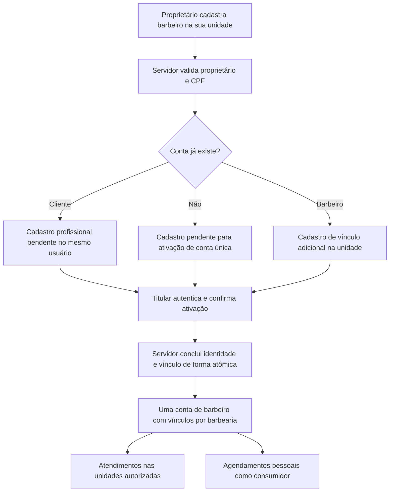

# Autenticação e permissões: análise e registro de decisões

Data: 2026-10-03.
Estado: desenho e decisões aprovados pelo usuário em 2026-10-03; planos detalhados em elaboração/revisão. Esta aprovação não autoriza implementar ou publicar issues automaticamente.

Desenho aprovado: [Autenticação completa](DESENHO_AUTENTICACAO_2026-10-03.md). Contrato detalhado para revisar junto aos planos: [Autenticação v1](CONTRATO_AUTENTICACAO_2026-10-03.md).

## Objetivo e escopo confirmado

Finalizar os fluxos de autenticação de cliente, barbeiro, proprietário e administrador da plataforma, com foco no front-end e contratos explícitos para a equipe de back-end. Preservar a arquitetura existente. Após consolidar e revisar os planos, preparar as issues para o projeto da organização no GitHub.

O administrador da plataforma representa o gestor e dono do Smart Barber. A entrega atual cobre sua autenticação e acesso à área correspondente. Métricas da plataforma, administração/concessão de planos e acesso a funcionalidades por plano são objetivos de evolução; o usuário explicitamente retirou a implementação de planos e seu controle de acesso do escopo atual, delimitando esta entrega à autenticação. O detalhamento de métricas fica como objetivo futuro nesta revisão de escopo, a validar na revisão final.

Não houve implementação de autenticação, execução de migrações, alteração de dados, publicação de issues, commit, push ou deploy nesta análise.

## Proveniência e limites da análise

| Checkout inspecionado | Branch | HEAD |
| --- | --- | --- |
| `D:/smart_barber/Smart-Barber-frontend-mobile-web` | `fix/auth-users-endpoint-compatibility` | `bf650406967f67c21337567544774578b3b5df99` |
| `D:/smart_barber/api` | `main` | `5564d5bf0df757389ef6f4b508f748fe7cc0035a` |

O front-end contém alterações anteriores em `SMART_BARBER_DESIGN_SYSTEM_V2.md`, `DESIGN.md` e `docs/PLANO_SEED_DB_DEMONSTRACAO_PRODUCAO_2026-09-28.md`. Esses arquivos foram preservados.

Existe outro worktree em `D:/smart_barber/worktrees/dashboard-navegacao`, no HEAD `ed7faca`, branch `feat/glass-cards-and-light-theme`. Ele recebeu leitura pontual; não é a base escolhida para implementação. O checkout aberto e esse worktree não devem ser tratados como equivalentes.

A análise é estática, sobre os arquivos locais. Não comprova o comportamento do deploy, a configuração de produção ou integração HTTP real. Não foi iniciado o servidor da API: seu boot chama migrações. Não foram lidos segredos ou credenciais de demonstração. Nenhum teste foi executado nesta etapa.

## Decisões registradas

| ID | Estado | Decisão | Alternativas e fundamento |
| --- | --- | --- | --- |
| D01 | Confirmada pelo usuário | Cada conta terá um único tipo de usuário. | A alternativa de acumular tipos na mesma conta foi apresentada e não foi escolhida. |
| D02 | Direção solicitada pelo usuário | Uma tela de login, com identificação automática do acesso pelo sistema. | O seletor de tipo antes do login foi mencionado, mas o usuário declarou preferência pela identificação automática. Contrato técnico ainda será desenhado. |
| D03 | Confirmada pelo usuário | O proprietário pode administrar e atender clientes, com agenda própria, mantendo o tipo proprietário. | A alternativa de proprietário apenas gestor foi apresentada. A escolha deve ser refletida nas permissões e na habilitação para atendimentos. |
| D04 | Confirmada pelo usuário | Publicar issues somente depois da consolidação e revisão dos planos. | A publicação não está autorizada como ação imediata. |
| D05 | Confirmada e esclarecida pelo usuário | O proprietário inicia e preenche o cadastro do barbeiro. Não existe cadastro profissional autônomo. | O aceite/ativação pelo titular continua coerente com o convite aceito previamente escolhido; não é uma entrada profissional iniciada pelo barbeiro. |
| D06 | Confirmada pelo usuário | Um CPF identifica uma única conta. Não permitir contas separadas de cliente e barbeiro com o mesmo CPF. | A possibilidade de contas separadas com e-mails distintos foi apresentada e rejeitada. |
| D07 | Confirmada como requisito pelo usuário | Quando o proprietário cadastra um barbeiro cujo CPF já pertence a um cliente, tratar a transição da conta existente. | Momento da mudança de tipo, protocolo de ativação e autorização são propostas técnicas ainda em revisão. Não excluir a conta antiga nem criar uma segunda identidade. |
| D08 | Confirmada pelo usuário | Após a transição, a conta de barbeiro pode fazer e consultar agendamentos próprios como consumidor. | Manter o tipo BARBER e conceder essa capacidade, sem um segundo tipo, conta ou CPF. Não acessar reservas de outros clientes por essa permissão. |
| D09 | Confirmada pelo usuário | Um barbeiro pode integrar várias barbearias com a mesma conta. | Vínculos separados por unidade, cada um iniciado pelo proprietário correspondente. Remoção em uma unidade não remove vínculo nas demais. |
| D10 | Confirmada pelo usuário | Manter o tipo BARBER após perder o último vínculo profissional. | Preservar identidade/perfil profissional e funções pessoais, sem acesso operacional a unidades sem vínculo ativo. A alternativa de voltar automaticamente a CLIENT foi rejeitada. Essa decisão permite evolução futura de contratação e oportunidades profissionais. |
| D11 | Confirmada pelo usuário | Para confirmar agendamento, o cliente deverá criar uma conta e estar autenticado. | O usuário escolheu essa exigência para reduzir spam. Não haverá confirmação de reserva como convidado. A consulta pública já existente é preservada. |
| D12 | Confirmada pelo usuário | Exigir confirmação do e-mail antes de permitir agendamento. | Cadastro e autenticação não bastam para liberar reservas. O front-end mantém a seleção enquanto o titular conclui a verificação; o servidor aplica a exigência. |
| D13 | Confirmada pelo usuário; fluxo já existente | O proprietário cadastra sua conta e barbearia pelo processo já pronto no projeto. | O usuário esclareceu que esse fluxo está concluído e deve ser preservado. Não planejar sua reconstrução. Concessão de plano será tratada separadamente. |
| D14 | Confirmada pelo usuário | Administrador é o gestor/dono do Smart Barber; a entrega atual cobre autenticação. Planos, concessões e controle de funcionalidades por plano ficam para evolução futura. | As alternativas de implementação manual de planos e cobrança automática foram retiradas do escopo atual pelo usuário. Não criar contratos ou tarefas de entitlements/cobrança como dependência da autenticação. |
| D15 | Confirmada pelo usuário | Usar e-mail e senha, confirmação por e-mail e recuperação de acesso, aproveitando a estrutura atual. | Google e Apple ficam para evolução futura. Não incluir OAuth/OIDC social como dependência desta entrega. |
| D16 | Confirmada pelo usuário | Autenticação em duas etapas fica para evolução futura. | Nesta entrega, inclusive para o administrador, manter e-mail/senha, confirmação por e-mail e recuperação. Não criar telas, rotas ou dependências de MFA como requisito atual. |
| D17 | Confirmada pelo usuário | Manter a sessão ao fechar e reabrir aplicativo/navegador, até sair ou expirar, com validade menor para o administrador. | A alternativa de exigir login em toda abertura foi rejeitada. Durações, renovação/revogação e mecanismos web/nativo serão propostos no desenho técnico. |
| D18 | Aprovada pelo usuário com o desenho | Evoluir a identidade única/vínculos; refresh web em cookie e nativo em SecureStore; sessão comum até 30 dias e gestor até 8h; OWNER também pode fazer reservas pessoais. | Mantém a arquitetura atual. Proxy API na origem web é requisito do desenho, não configuração já existente ou deploy autorizado. |
| D19 | Refinamento técnico da revisão cética | Fechar concorrência, tipos incompatíveis, OWNER pendente/legado, fontes de refresh, saída offline e estados de ativação no contrato C01–C10. | As objeções abaixo são atendidas sem incluir recursos futuros ou reabrir decisões de produto. Os detalhes seguem para a revisão dos planos. |

### Revisão especializada: objeções e resolução

| Objeção cética | Resolução no contrato | Justificativa |
| --- | --- | --- |
| S1: CPF passa a existir durante ativação. | C06 reconsulta transacional, 409 ACTIVATION_REQUIRES_SIGN_IN e autenticação da identidade correspondente. | Preserva ID/credenciais; token não autoriza fusão. |
| S2: tipos incompatíveis/entrada em onboarding OWNER. | C02/C06 ACCOUNT_ROLE_CONFLICT; C07 não acrescenta conversão autônoma para OWNER. | Preserva tipo único e comportamento de conflito já existente no cadastro OWNER. |
| S3: confirmação de e-mail regride OWNER. | C02 permite setup do novo OWNER pendente; legado classificado preserva gestão sem fabricar emailVerified. | Mantém jornada pronta; reserva pessoal exige confirmação em todos os tipos de consumidor. |
| S4: navegador escolhe transporte nativo. | C04 valida Origin/fontes e vincula transporte à sessão; proíbe troca cookie/corpo. | Campo fornecido pelo app não desliga a proteção web. |
| S5: duas abas/resposta de refresh perdida. | C04 CAS, chave idempotente, replay cifrado 30s, disputa 409 e reutilização tardia revogadora. | Recupera perda de resposta sem prolongar expiração absoluta. |
| S6: logout offline/reinício/resposta tardia. | C04 marcador persistente e evento entre abas antes de await; remoção condicionada a revogação/novo login explícito. | Credencial restante no cookie não restaura acesso silenciosamente. |
| S7: auth versus confirmação comercial de reserva. | C08 separa policy/leituras/agenda existentes de criação de reserva ainda ausente. | Não declarar reserva real concluída com fixtures ou policy isolada. |
| S8: estados recusados e preview sem contrato. | C06 preview e decline explícitos, sem consumo por leitura. | Cada estado do ciclo tem caminho definido e dados mínimos. |
| S9: aprovação ainda marcada pendente. | D18 e desenho atualizados com aprovação em 2026-10-03. | Distingue aprovação do desenho da revisão posterior de planos e publicação. |
| G1: revogação de segurança pode ser desfeita por rollback. | C04/C09 e B02/B03 distinguem aborto de operação inconsistente de DENIED_REVOKED com commit antes de401. | Resposta negativa não equivale automaticamente a rollback de uma medida de segurança. |
| G2: outro token de reset continua válido após mudar senha. | C05/B04 invalidam todos os tokens de reset do titular, com serialização por usuário. | Links antigos e concorrentes não substituem a senha recém-definida. |
| G3: replay de refresh reemite geração superada. | C04/B03 exigem que geração do replay ainda seja atual; caso contrário409 sem credencial/Set-Cookie. | Não regredir cookie/refresh nem ressuscitar sessão revogada. |
| U1: ativação nova não emite sessão, mas UI consulta /me. | C06/F06 distinguem conta nova → login explícito de conta já autenticada → refreshProfile. | Não consultar endpoint autenticado antes de haver sessão. |
| U2: confirmação mantém perfil pendente antigo. | F04 reconsulta perfil após204 e resolve destino; falha vira recuperação sem repetir setup. | Preserva barbearia criada e não prende titular em loop. |
| U3: recusa/troca de conta ambíguas. | C06/F06 definem mensagens, titular correspondente para recusa e troca explícita cancelável. | Não revelar destinatário nem simular aceite/elevação. |
| U4: senha Unicode versus limite bcrypt. | C01/F04 validam UTF-8 sem truncar; mensagem simples e testes de acentos/emoji. | Regra UI/API equivalente sem quebrar senha legada no login. |
| U5: saída offline anunciada como global. | C04/F03 mensagens derivadas de LogoutResult, diferenciando persistência local e revogação remota. | Só declarar saída global quando o servidor a confirmou. |

Disposição do revisor integrador: **APPROVED para revisão humana dos planos** em 2026-10-03. S1–S9, G1–G3 e U1–U5 foram aceitas e resolvidas; nenhuma objeção rejeitada e nenhuma pendência técnica bloqueante remanescente. Essa aprovação é documental: não comprova código, testes, banco, e-mail, deploy ou publicação. Ajustes finais da autorrevisão explicitam parser do envelope staff legado, data original de criação, fuso da reserva e tipos locais de erro, sem ampliar escopo.

O cadastro de proprietário/barbearia é uma base existente, conforme confirmação do usuário. O trabalho atual concentra-se em cliente, barbeiro, administrador e ciclo comum de identidade/sessão/permissões. Alterações pontuais de integração no fluxo OWNER só deverão constar quando necessárias para CPF único, compatibilidade de contratos, verificação ou roteamento, com preservação da jornada e das funcionalidades já prontas. O registro estático de limitações técnicas não transforma esse fluxo em uma nova funcionalidade a construir.

O tipo de conta e o vínculo com a barbearia continuam determinando a autorização das rotas pertinentes. Esse controle de identidade/escopo é parte da autenticação completa; um plano comercial não será consultado para decidir os acessos nesta entrega.

O método comum de entrada confirmado em D15 é e-mail/senha. A verificação do e-mail e a recuperação de acesso integram o ciclo de identidade. Conforme D16, autenticação em duas etapas será evolução futura, inclusive para o gestor. Google/Apple também pertencem ao registro de evolução futura, com contratos próprios a desenhar quando esses escopos forem ativados.

## Arquitetura encontrada

Front-end: Expo, React Native Web, Expo Router, TypeScript, TanStack Query, React Hook Form e Zod. As responsabilidades já estão organizadas em `app`, `features`, `entities` e `shared`; autenticação possui `api`, `model`, `lib`, `ui` e `tests`.

Back-end: Express e TypeScript; entidades e objetos de valor em `domain/enterprise`; casos de uso e portas de repositório em `domain/application`; controllers, factories, middlewares e rotas em `infra/http`; PostgreSQL e adaptadores Drizzle em `infra/drizzle`. Casos de uso recebem repositórios por construtor e retornam `Either`.

O domínio atual usa `User`, não uma entidade independente de credenciais para cada tipo. `membership` contém o papel do usuário em uma barbearia. O catálogo enumera `OWNER` e `BARBERMAN`; não há tipo global de conta, administrador da plataforma ou cliente explícito no schema inspecionado. A nova decisão D01 exige compatibilização com essa estrutura, sem inferir o tipo somente pela ausência de vínculo.

E-mail e CPF são obrigatórios e únicos globalmente (`api/src/infra/drizzle/schema.ts:29,31`). `CreateUserUseCase` rejeita duplicidade de qualquer um. D06 mantém a exclusividade de CPF e exige tratar a evolução da identidade existente. As buscas atuais de e-mail/CPF no repositório usam igualdade exata; a política de normalização também precisa constar do contrato. A unicidade textual atual não deve ser confundida com unicidade comprovada entre CPF formatado e CPF somente com dígitos.

O schema admite vários vínculos por usuário, com unicidade apenas do par barbearia/usuário. Hoje uma conta pode ser OWNER em uma unidade e BARBERMAN em outra. Esse caso existente precisa de tratamento explícito na migração da regra D01; não se deve classificar a conta pelo primeiro vínculo retornado nem descartar vínculos conflitantes.

A possibilidade de o proprietário atender tem suporte estrutural parcial: `bookings.barbermanId` e as agendas referenciam `users.id`; os controllers de agenda usam o ID autenticado. Isso não comprova um fluxo completo de profissional proprietário na UI/API. O caso de atualização de horários não valida, por si, que o profissional alvo pertence à unidade; essa autorização deverá ser contemplada.

Verificações específicas do cadastro atual: `CreateUserController` usa apenas `z.string()` para CPF; `CreateUserUseCase` encaminha o valor sem validar/normalizar CPF. `findByCpfOrEmail` combina duas identidades possíveis com OR e devolve o primeiro resultado; não basta para resolver CPF de uma conta com e-mail de outra. `UsersRepository.save` faz INSERT sem preservar o ID fornecido pela entidade; não pode ser usado como atualização na transição. A verificação prévia de duplicidade não trata explicitamente a corrida antes do INSERT, podendo resultar em 500 numa violação concorrente de unicidade.

Há um precedente de transação para criação de barbearia e vínculo OWNER em `DrizzleBarbershopsRepository`, mas as portas atuais não oferecem atualização do tipo do usuário, convite ou inclusão/ativação de membro. A evolução exige contratos específicos de persistência, mantendo as camadas existentes.

## Transição de cliente para barbeiro: proposta em revisão

### Requisitos aceitos e desenho proposto

Aceitos: uma conta por CPF; um tipo por conta; o proprietário cadastra o barbeiro; cliente existente deve ser aproveitado. A proposta abaixo detalha como cumprir esses requisitos, sem afirmar que o protocolo já foi aprovado ou implementado.

Comparação das abordagens compatíveis com a unicidade de CPF:

| Abordagem | Benefício | Custo ou risco | Avaliação |
| --- | --- | --- | --- |
| Proprietário cadastra; titular ativa; servidor reaproveita a identidade existente. | Mantém a origem do cadastro no proprietário e confirma quem terá o acesso. | Exige estado pendente e fluxo de ativação. | Recomendada; aproveita a decisão anterior de convite aceito. |
| Proprietário cadastra e converte imediatamente a conta existente. | Menor número de etapas. | O conhecimento de um CPF permitiria alterar a experiência/permissões de outra pessoa antes de sua confirmação. | Menor proteção para identidade e transição; não recomendada. |
| Proprietário cadastra e administrador da plataforma revisa a conversão. | Revisão operacional adicional. | Dependência de atendimento e atraso para toda conversão. | Reservar revisão para conflitos que não possam ser resolvidos pelo titular. |

O CPF serve para localizar e garantir unicidade, não como prova suficiente de titularidade ou credencial. O titular ativa seu acesso; não escolhe se tornar barbeiro por um formulário público.

O diagrama representa a proposta recomendada de ativação. Tipos incompatíveis, identidade sem verificação e convites inválidos não seguem automaticamente para sua conclusão.

### Jornada recomendada

1. O proprietário abre **Equipe → Cadastrar barbeiro** e informa nome, CPF, e-mail de contato e os demais dados mínimos a definir. A unidade vem do contexto que o servidor autoriza.
2. O servidor normaliza/valida o CPF, verifica a permissão do proprietário naquela barbearia e procura uma conta existente. O cadastro não aceita tipo/role privilegiado escolhido livremente no corpo.
3. CPF novo: persistir o cadastro profissional pendente, iniciado pelo proprietário. O barbeiro recebe ativação para verificar seu contato e definir sua senha. A proposta é criar a conta única e o vínculo ativo na conclusão autorizada, sem fabricar um usuário CLIENT intermediário nem senha compartilhada pelo proprietário. Concorrência com outra solicitação ou cadastro de cliente deve ser resolvida na mesma identidade.
4. CPF de cliente existente: preparar a entrada profissional associada ao mesmo `userId`. Preservar nome/contatos/credenciais da conta; dados profissionais adicionais não sobrescrevem silenciosamente a identidade. O titular entra na conta existente e confirma a ativação.
5. Na ativação válida, efetivar a transição `CLIENT → BARBER` (ou criar a identidade BARBER para CPF ainda inexistente), o vínculo com a unidade, o consumo da ativação e o registro de auditoria na mesma transação. Antes disso, a conta existente continua com o tipo e os acessos que já tinha. Revalidar CPF/e-mail e permissões no momento de concluir.
6. Atualizar o contexto de sessão e as permissões; o login único passa a direcionar a conta à área profissional. Uma operação pendente/negada não modifica a conta nem concede acesso à equipe.

Para contas existentes, o contato informado pelo proprietário não substitui automaticamente o contato de recuperação nem recebe poder de ativar a conta. A confirmação deve ocorrer na identidade já verificada do titular. Sem contato verificado, definir um fluxo de verificação/recuperação em vez de transferir a conta para o e-mail fornecido pelo proprietário.

### Casos que o contrato precisa cobrir

| Condição | Resultado proposto |
| --- | --- |
| CPF ainda não existe. | Cadastro profissional pendente; ativação cria uma única conta e vínculo; sem acesso operacional antes de ativar. |
| CPF pertence a cliente ativo. | Reaproveitar conta; transição pendente; preservar login, senha, ID e reservas. |
| CPF pertence a barbeiro já ativo. | Reaproveitar conta e cadastrar o vínculo com a unidade do proprietário. Vínculo repetido não cria duplicata; D09 permite vínculos em várias unidades. |
| CPF pertence a proprietário. | Não rebaixar automaticamente para BARBER. O proprietário já pode atender conforme D03; vínculo com outra unidade exige regra específica. |
| CPF pertence a administrador, conta bloqueada ou tipo ainda não classificado. | Não converter por esse fluxo. Encaminhar o conflito sem conceder acesso ou revelar detalhes privados da conta. |
| E-mail pertence a outro CPF. | Não juntar contas nem trocar CPF/e-mail. Resolver conflito por fluxo de identidade autenticado; não revelar dados de outra pessoa. |
| Convite expirado, recusado ou revogado. | Não mudar tipo nem criar vínculo ativo. Manter a conta existente. |
| Convite usado por outra conta. | Não ativar; token e identidade autenticada devem corresponder ao destinatário. |
| Proprietário perdeu permissão ou unidade deixou de aceitar equipe. | Revalidar na ativação; não efetivar a operação só porque o convite já havia sido emitido. |
| Cadastro/ativação repetidos ou concorrentes. | Uma identidade por CPF canônico e um vínculo por par usuário/unidade; resposta consistente sem segunda conversão. |
| Cadastro de cliente disputa o mesmo CPF com cadastro profissional pendente. | Resolver pela mesma identidade e estado de ativação; não criar contas paralelas nem bloquear o titular sem caminho de recuperação. |

Remover um vínculo profissional não autoriza excluir a conta ou seu histórico. A unidade removida perde acesso operacional para esse barbeiro; outras unidades e operações pessoais continuam sujeitas às suas próprias autorizações. Conforme D10, mesmo após o último vínculo, a conta mantém o tipo BARBER e os acessos pessoais. O estado sem vínculos ativos não é bloqueio global da conta, não autoriza criar barbearia como OWNER e não concede acesso às agendas de outras unidades. Um novo proprietário pode iniciar um novo vínculo usando a mesma identidade.

### Possível evolução futura: oportunidades profissionais

O usuário indicou como evolução possível: barbearias anunciarem vagas; barbeiros montarem um perfil profissional, candidatarem-se, agendarem testes e receberem propostas. Esse conjunto de funcionalidades é contexto futuro, não requisito de entrega da autenticação atual nem autorização para criar agora módulos ou rotas de recrutamento.

D10 preserva a identidade profissional independentemente do vínculo de emprego, oferecendo uma base para essa evolução. O modelo atual a planejar deve distinguir tipo de conta, perfil profissional e vínculos autorizados com unidades. Candidatura ou teste futuro não deverá conceder, por si, acesso operacional à barbearia; as regras de recrutamento e contratação serão desenhadas quando esse escopo for ativado.

### Preservação do histórico

Manter o mesmo `users.id` permite preservar as referências existentes dos carrinhos e reservas (`shoppingCarts.userId → users.id`; `bookings.shoppingCartId → shoppingCarts.id`). A mudança de tipo não reatribui reservas de consumidor ao profissional, não altera preços/histórico e não cancela reservas futuras. D08 confirma o acesso aos próprios agendamentos como consumidor, mantendo o tipo BARBER; a UI deve distinguir os atendimentos prestados das reservas feitas pela própria pessoa.

A barbearia recebe os dados necessários do integrante de sua equipe, não o histórico de consumo do titular em outras unidades. CPF completo, contato de recuperação e existência de conta de cliente não devem ser expostos como resultado de uma pesquisa indiscriminada.

### Front-end e contratos candidatos para esse ramo

No front-end, o proprietário terá cadastro/listagem de equipe e estados de ativação pendente, ativa, recusada, expirada e revogada. O titular terá entrada autenticada para ativação e confirmação; um link não cria outra conta quando o CPF já existe. Depois da transição, reconsultar a identidade/permissões e invalidar os caches do contexto anterior.

A área profissional deve contemplar **Minha agenda de atendimentos** e **Meus agendamentos como consumidor** como tarefas distintas dentro da mesma conta. A navegação não seleciona um segundo tipo de login; cada operação será autorizada pelo contexto e pela relação do usuário com a reserva.

Com várias unidades, a seleção da barbearia deve usar apenas vínculos autoritativos e ativos. CPF/tipo global BARBER não basta para entrar na agenda de uma unidade. Consultas, cache e mutações devem distinguir o usuário e a unidade; a agenda profissional precisa de contrato com escopo de unidade para não misturar atendimentos, pois as rotas atuais operam pelo profissional/data.

Estas rotas são candidatas e ainda não compõem um contrato aprovado:

- `POST /api/barbershops/:shopId/barbers`: proprietário inicia o cadastro com dados mínimos; autoria deriva do token. Retorno proposto: 202 com `{registrationId,status:"PENDING_ACTIVATION"}`. Uma resposta pendente não significa envio de mensagem concluído. Não retornar perfil de cliente, senha ou token de ativação ao proprietário.
- `GET /api/barbershops/:shopId/barbers`: equipe autorizada da unidade e estados de cadastro, com dados mínimos e paginação.
- Operações de reenvio/revogação sobre o cadastro pendente, restritas ao proprietário autorizado da unidade. Método e caminho finais a definir no contrato completo.
- Operação de ativação do titular, com token de uso único, validade, destinatário e barbearia vinculados no servidor; para conta existente, exigir sua autenticação. Para CPF novo, combinar a ativação com estabelecimento seguro das credenciais. Esses dois ramos não devem ser simulados por um segundo POST de cadastro público.
- Ampliar `GET /api/users/me` para informar tipo, estado e acessos autoritativos; preservar a descoberta de unidades como contexto de autorização, não como prova de tipo por ausência/presença.

Entrega de ativação e reenvio devem tolerar falha sem converter a conta e sem duplicar cadastros. A publicação de evento/mensagem ocorre após persistência consistente; a aceitação da requisição e a entrega da mensagem são estados diferentes.

### Aceitação específica a incluir no plano

Verificar CPF com e sem máscara, dígitos inválidos, e-mail de outro titular, preservação de `userId`/senha/contato/reservas, conversão apenas na ativação autorizada, ausência de acesso profissional pendente, repetição/concorrência, convite revogado, autor sem permissão, limites de unidade, falha de entrega e atualização de sessão em web/nativo. Não incluir CPF, senha ou tokens completos nos registros de auditoria.

Referências: a recomendação de autenticar o titular para concluir uma alteração sensível de sua conta se apoia nos controles de [reautenticação da OWASP](https://cheatsheetseries.owasp.org/cheatsheets/Authentication_Cheat_Sheet.html#require-re-authentication-for-sensitive-features). A exigência de revalidar autorização do proprietário na unidade em cada operação se apoia na [verificação de permissões por requisição da OWASP](https://cheatsheetseries.owasp.org/cheatsheets/Authorization_Cheat_Sheet.html#validate-the-permissions-on-every-request). Aplicar esses controles à ativação profissional é uma recomendação deste desenho.

## Cliente: conta obrigatória e redução de spam

D11 confirma a exigência de conta e autenticação para efetivar uma reserva. Isso identifica a conta responsável e permite aplicar regras de uso por titular. Cadastro público de cliente não concede função de barbeiro nem acesso à equipe.

Jornada a detalhar no plano: catálogo público → escolha de serviços/unidade → entrar ou criar conta → completar eventuais verificações → voltar à seleção preservada → consultar disponibilidade atual e confirmar reserva pelo servidor. A seleção anterior ao login não segura um horário nem assegura preço/disponibilidade; o servidor revalida a operação na confirmação. O retorno após login usa destino interno permitido, sem redirecionamentos arbitrários.

O usuário já aceitou em D08 que barbeiros podem usar funções de consumidor na própria conta. Essa autorização exige autenticação e vínculo da reserva ao titular, sem necessidade de novo CPF ou cadastro CLIENT. O `userId` da reserva pessoal vem da sessão; campos enviados pelo app não podem escolher outro titular.

### Controles complementares propostos

A exigência de conta é parte da proteção contra spam. Também propor no desenho:

- Verificação de e-mail com token de uso único e validade; D12 exige concluir essa verificação antes de permitir reservas. E-mail verificado comprova controle do contato, não titularidade legal do CPF.
- Limites de cadastro, entrada, envio/reenvio de confirmação e recuperação, com aplicação no servidor.
- Limites de tentativas de reserva por conta e contexto, idempotência e análise de padrões de abuso. Critérios e valores serão definidos na especificação; não inventar limites de reservas ativas antes de conhecer as regras de produto.
- Erros HTTP/códigos estáveis para verificação pendente, limitação temporária, sessão inválida e falta de permissão, com mensagens e nova tentativa orientadas no front-end.
- Verificações em cada operação de reserva; desabilitar botão no app ou limitar apenas por IP não representa toda a proteção.

A exigência de confirmação de e-mail é decisão aceita em D12. Os detalhes de tokens, limites e códigos HTTP continuam como propostas técnicas a especificar, não recursos existentes nem valores já aprovados. Sua motivação é apoiada pela [OWASP sobre verificação de e-mail](https://cheatsheetseries.owasp.org/cheatsheets/Email_Validation_and_Verification_Cheat_Sheet.html) e pela [OWASP API6 sobre abuso automatizado de fluxos de negócio](https://api-security.owasp.org/editions/2023/en/0xa6-unrestricted-access-to-sensitive-business-flows/). A autenticação, isoladamente, não impede uso abusivo de uma conta válida.

Para a UI, os estados incluem criação da conta, verificação pendente, envio solicitado, falha de entrega/reenvio, link expirado, e-mail confirmado e retorno ao agendamento. A seleção local é somente intenção: não reservar antecipadamente um slot durante cadastro/verificação. A conta BARBER com funções de consumidor obedece à mesma exigência de contato verificado para reservar.

O contrato de reserva deverá identificar ausência de verificação com código estável e resposta adequada, impedindo que uma chamada HTTP direta contorne a tela. Também cobrir verificação repetida, token expirado/inválido, limite de reenvio e disponibilidade alterada enquanto o titular confirmou o e-mail.

## Contratos existentes na API

As rotas abaixo foram verificadas nos arquivos de rotas e controllers. Os status são os retornos de sucesso encontrados no código, não resultados de chamadas HTTP.

| Método e rota canônica | Contrato encontrado | Limitação para o escopo |
| --- | --- | --- |
| `POST /api/users/` | Corpo: `name,email,password,cpf`; 201 com `{userId}`. | Não distingue a finalidade da conta; não cria vínculo profissional por esse fluxo. |
| `POST /api/users/sessions/auth` | Corpo: `email,password`; 201 com `{access_token}`. | Não entrega tipo, contextos ou ciclo de renovação de sessão. |
| `GET /api/users/me` | Autenticada; 200 com `{user,staff:user}`; perfil inclui ID, nome, e-mail, avatar e telefone. | Sem tipo global, status de conta, verificação de e-mail, permissões ou acesso administrativo. |
| `GET /api/users/me/barbershops` | Autenticada; 200 com `{barbershops:[{id,name,role,status,timezone}]}`. | O status é da barbearia. O vínculo não tem ciclo explícito de convite, suspensão ou revogação. |
| `POST /api/barbershops/` | Autenticada; criação inclui proprietário e membership OWNER. | O desenho precisa decidir quem pode iniciar o cadastro e como planos interferem nessa operação. |
| `GET /api/barbershops/:shopId` | Leitura pública da barbearia. | Consultar uma barbearia não demonstra que o usuário integra a equipe. |
| `GET /api/bookings/barberman/schedule` | Autenticada; usuário do token vira o `barbermanId`. | Agenda do próprio profissional; não é contrato de agenda de toda a equipe. |
| `GET /api/bookings/barberman/schedule/details` | Autenticada; usuário do token vira o `barbermanId`. | Mesma limitação; não implementa a visão de reservas do cliente. |
| `DELETE /api/bookings/:bookingId/cancel` | Autenticada; usuário do token é comparado ao profissional da reserva. | Não cobre cancelamento pelo cliente ou gestão pelo proprietário como políticas independentes. |

`/api/staffs` usa o mesmo router de `/api/users`; é alias de compatibilidade, não autenticação distinta. Catálogo e disponibilidade possuem rotas de leitura pública. Há um caso de uso `FetchClientBookingsUseCase`, mas ele consulta por `shoppingCartId`, sem rota HTTP de cliente montada nos routers inspecionados e sem identidade autenticada do cliente no DTO.

## Lacunas concretas do front-end

| Achado | Evidência | Consequência |
| --- | --- | --- |
| Sessão modelada como Staff | `src/features/auth/model/auth-state.ts:14`; `src/entities/staff/model/staff.types.ts:7` | Tipos suportados: OWNER, BARBER e UNKNOWN. Cliente e administrador não possuem sessão e destinos próprios. |
| Redirecionamento pela existência de barbearia | `src/app/_layout.tsx:34` | Um cliente autenticado sem barbearia seria enviado a `barbershop-setup`. |
| Contexto salvo não revalida membership | `src/features/auth/model/use-session.tsx:30` | A leitura pública por ID salvo é usada para resolver contexto; isso não prova vínculo ativo. |
| Descoberta silenciosamente falha | `src/features/auth/model/use-session.tsx:64` | Indisponibilidade e ausência de vínculo ficam indistintas; pode aparecer onboarding indevido. |
| Método de vínculo infere BARBER | `src/features/auth/model/use-session.tsx:312` | A API interna `linkBarbershop` atribui BARBER quando o usuário não é proprietário, sem obter confirmação de membership. A tela atual não expõe necessariamente esse método. |
| DTO de cadastro diverge | `src/features/auth/api/auth.dto.ts:21` e controller backend `create-user-controller.ts:44` | Front declara `{staffId}`, API retorna `{userId}`. O fluxo atual ignora esse ID, mas o contrato está inconsistente. |
| Cadastro apresenta todos como proprietários | `src/features/auth/ui/RegisterForm.tsx:37`; `src/features/auth/ui/LoginForm.tsx:98` | Comunicação e onboarding não contemplam cliente e convite profissional. |
| Logout somente local | `src/features/auth/model/use-session.tsx:354` | Apaga storage/cache, mas não revoga o token no servidor. |
| Renovação ausente | `src/features/auth/model/use-session.tsx:107`; `src/shared/api/http-client.ts` | Token expirado remove a sessão; não existe protocolo de refresh. |
| Armazenamento por plataforma já separado | `src/shared/storage/token-storage.web.ts`; `token-storage.native.ts` | Web usa sessionStorage; nativo usa SecureStore. Contrato futuro precisa respeitar diferenças de browser e aplicativo. |
| Testes de sessão não montam o provider | `src/features/auth/tests/session-engine.test.ts` | Operam API simulada e storage; não comprovam o guard, a resolução de contexto ou as condições de corrida do SessionProvider. |

## Lacunas concretas do back-end

1. **Rotas de manutenção sem autenticação no código local:** `src/app.ts:38` registra `GET /api/system/migrate`; `src/app.ts:46` registra `GET /api/system/demo-seed`; `src/app.ts:65` registra `POST /api/system/demo-seed`. Não há middleware de autenticação nessas cadeias. O POST pede uma confirmação literal; ela não identifica nem autoriza um administrador. Não houve chamada dessas rotas nem verificação de exposição em produção. Tratar esse achado na frente prioritária de segurança do plano.
2. **Falha de token retorna 500:** `ensure-user-is-authenticated.ts:30-43` captura falha de `verify` junto com falha de repositório e responde 500. Sessão inválida/expirada e indisponibilidade precisam ser distinguíveis para o front-end.
3. **JWT só identifica o usuário:** `sign-in-user.ts:38` assina `sub` com expiração. Não há sessão persistida, refresh, revogação, logout remoto ou estado de MFA nos módulos inspecionados.
4. **Sem ciclo de vida da identidade:** não foram encontradas rotas e modelos para recuperação/troca de senha, verificação de e-mail, bloqueio de conta, convites e administração de permissões.
5. **Administração comercial ainda inexistente, fora da entrega atual:** não foram encontrados contratos de planos, assinaturas, concessões ou limites comerciais. Conforme D14, a ausência desses módulos não bloqueia o plano de autenticação do gestor. O planejamento atual precisa do acesso administrativo protegido e do provisionamento da identidade; administração comercial será desenhada em evolução própria.
6. **Identidade protegida no adaptador:** `express-route-adapter.ts` atribui `userId` a partir de `request.user?.sub` depois de incorporar corpo, parâmetros e query. Preservar essa propriedade nos contratos futuros; identidade do autor não deve vir de um campo arbitrário do corpo.
7. **Senha não aparece no perfil público da sessão:** `get-user-profile.ts` faz projeção explícita dos campos do perfil. Preservar essa separação ao ampliar `/me`.

### Persistência web/nativo: verificação de configuração rastreada

O frontend publica export estático Expo (`package.json:10`, `app.json:28-31`); `vercel.json:3-10` possui somente o fallback universal para `/index.html`, sem proxy `/api`. A API padrão em `src/shared/config/env.ts:5` é absoluta e externa; esses defaults não comprovam os domínios publicados.

O cliente HTTP aceita opções `credentials`, mas as chamadas atuais de autenticação não as definem. `new URL(baseUrl + path)` não suporta simplesmente trocar a base por uma string relativa vazia; uma base web por origem exige adaptação. O backend usa `cors()` sem lista de origens/credenciais e não implementa refresh por cookie.

O storage web guarda acesso em sessionStorage; o nativo usa SecureStore. Nenhum contém família de refresh revogável. Cookie HttpOnly deve ser gerido pelo navegador, não lido pelo adaptador JavaScript.

O desenho propõe proxy sob a origem web e SecureStore no nativo. A execução futura deve validar Cookie/Set-Cookie, expiração, logout, Origin/CSRF e navegadores reais. Cross-origin não significa necessariamente cross-site; adotar API em outro site somente com flags de cookie não garante persistência em todos os navegadores. Não houve consulta a DNS, hosting ou headers reais nesta inspeção.

## Migração de identidade: achados para análise dedicada

Foram encontrados dois caminhos diferentes no código local. Não foi consultado nenhum banco; os achados abaixo são riscos estáticos e não demonstram dano ou execução dessas migrações.

- `api/drizzle/20260930183125_married_speed_demon/migration.sql:1-12` adiciona `user_type NOT NULL` antes de preencher, copia registros de customers sem preservar o ID e remove a tabela antes de ajustar a referência de shopping carts. Uma base populada exige verificação específica desse caminho.
- `api/drizzle/20260930185926_regular_rick_jones/migration.sql:1-2` remove o tipo posteriormente. Não existe atualmente um tipo global no schema final.
- `api/src/infra/drizzle/migrator.ts:100-121` preserva IDs, mas trata conflito apenas pelo ID, remove `customers CASCADE` e renomeia a coluna de carts; nessa seção não recria a FK removida. Conflitos de CPF/e-mail entre as antigas tabelas também exigem tratamento explícito.
- Antes de executar qualquer evolução, o plano deve prever inventário autorizado do schema e das migrações aplicadas, mapeamento de identidades e vínculos, integridade das referências, ensaio em cópia de teste e recuperação. Não reutilizar SQL gerado como se fosse comprovadamente equivalente ao migrator de boot.

## Árvore de decisões pendentes

As perguntas serão resolvidas conforme suas dependências. Este inventário não escolhe silenciosamente as respostas.

| Ramo | Decisões necessárias |
| --- | --- |
| Identidade e migração | CPF único confirmado; normalização de CPF/e-mail; classificação segura de usuários existentes; ativação da transição CLIENT → BARBER; outras mudanças futuras de tipo. |
| Proprietário e equipe | Proprietário inicia o cadastro confirmado; várias unidades confirmadas; tipo BARBER preservado após último vínculo; detalhar suspensão/remoção e ativação. |
| Cliente | Conta e e-mail confirmado obrigatórios para agendar; detalhar cadastro/dados mínimos, acesso a reservas próprias e retorno ao catálogo após login. |
| Administração atual | Identidade do gestor/dono da plataforma; provisionamento seguro sem cadastro administrativo público; e-mail/senha e área protegida. Detalhar os controles da sessão de alto privilégio; MFA pertence à evolução futura conforme D16. |
| Administração futura | Métricas da plataforma, gestão de usuários e permissões administrativas, planos/concessões e limites comerciais. Não são dependências da autenticação desta entrega. |
| Entrada e recuperação | E-mail/senha, confirmação por e-mail e recuperação confirmados; detalhar persistência, sessões simultâneas, duração e encerramento. Google/Apple e MFA são evolução futura. |
| Experiência e autorização | Destinos por tipo; seleção de unidade; links diretos; status pendente/bloqueado; acesso público; troca de conta e limpeza de cache. |
| Requisitos operacionais | Volume inicial e crescimento; metas de desempenho/disponibilidade; armazenamento web/nativo; privacidade e retenção; ambientes de validação e responsabilidade das equipes. |

## Entregáveis após as decisões

- Especificação revisável de autenticação: personas, permissões por identidade/vínculo, jornadas, estados, erros, transições e migração. Planos e suas permissões comerciais não entram nesta entrega.
- Contratos HTTP para a equipe de back-end: reutilizar/ampliar/criar rotas, corpos e respostas, autoria, escopo por barbearia, status e exemplos versionados.
- Planos de implementação por responsabilidade e dependência, com arquivos precisos, interfaces, testes de aceitação e verificações.
- Backlog revisado com separação por repositório e vínculo ao projeto da organização. Publicação somente após a revisão prevista em D04.

## Critérios de validação a detalhar no plano

Cobrir cada tipo na entrada e restauração, proprietário que atende, vínculo revogado, conta bloqueada, unidade diferente, acesso direto a rota proibida, falha de rede sem perda indevida da sessão, recuperação e renovação, encerramento remoto, conflito de cadastro e convites, confirmação de e-mail e isolamento de cache entre contas/unidades. Validações de expiração de plano e bloqueios comerciais pertencem à evolução futura indicada em D14.

Separar testes unitários com fixtures, integração HTTP com banco de teste e fluxo real de homologação web/Android/iOS. Nenhum desses níveis substitui os demais. A lista final dependerá das decisões abertas.

## Referências técnicas consultadas

Referências primárias para detalhar os controles de autenticação, autorização e sessão na especificação; não substituem decisões de produto ou validação do código.

- [OWASP: Authentication Cheat Sheet](https://cheatsheetseries.owasp.org/cheatsheets/Authentication_Cheat_Sheet.html).
- [OWASP: Authorization Cheat Sheet](https://cheatsheetseries.owasp.org/cheatsheets/Authorization_Cheat_Sheet.html).
- [OWASP: Session Management Cheat Sheet](https://cheatsheetseries.owasp.org/cheatsheets/Session_Management_Cheat_Sheet.html).
- [OWASP: Email Validation and Verification Cheat Sheet](https://cheatsheetseries.owasp.org/cheatsheets/Email_Validation_and_Verification_Cheat_Sheet.html).
- [OWASP: API6 — Unrestricted Access to Sensitive Business Flows](https://api-security.owasp.org/editions/2023/en/0xa6-unrestricted-access-to-sensitive-business-flows/).
