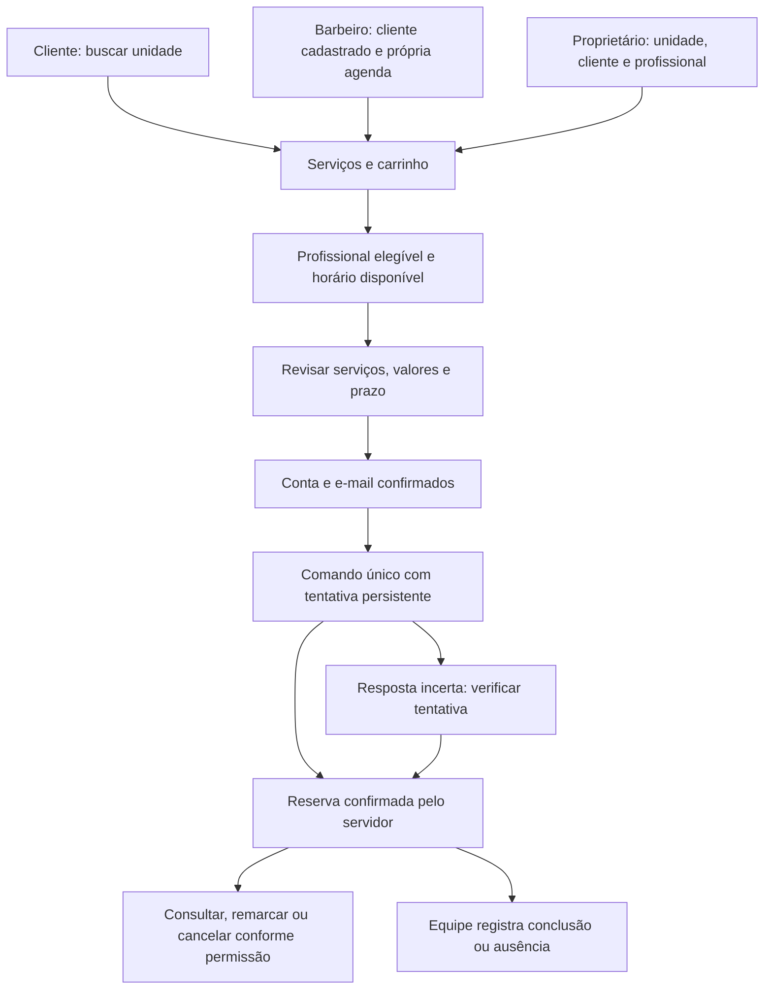

# Plano integrado — agendamento, equipe e homes

Estado: plano aprovado, D01–D16 preservadas. B1 concluída segundo o usuário; commit local `c432b53` da API confirmado. As 18 tarefas restantes foram reorganizadas, a pedido do usuário, em 6 grupos de desenvolvimento + homologação integrada, com uma execução/revisão independente por grupo. Esta reorganização não executou as próximas tarefas nem confirmou publicação da B1.

**Spec obrigatória:** [desenho e decisões](D:/smart_barber/Smart-Barber-frontend-mobile-web/docs/DESENHO_AGENDAMENTO_EQUIPE_E_HOMES_2026-10-11.md). [Análise de código](D:/smart_barber/Smart-Barber-frontend-mobile-web/docs/ANALISE_AGENDAMENTO_EQUIPE_E_HOMES_2026-10-11.md). [Backlog de geolocalização](D:/smart_barber/Smart-Barber-frontend-mobile-web/docs/backlog/geolocalizacao-barbearias.md).

Revisão sequencial concluída em [registro técnico](D:/smart_barber/Smart-Barber-frontend-mobile-web/docs/REVISAO_AGENDAMENTO_EQUIPE_E_HOMES_2026-10-11.md): 14 objeções aceitas/endereçadas, nenhuma bloqueadora residual. Aprovação do plano não equivale a código/homologação/produção.

Auditoria de reutilização solicitada posteriormente: [rotas/Swagger](D:/smart_barber/Smart-Barber-frontend-mobile-web/docs/AUDITORIA_ROTAS_SWAGGER_API_2026-10-11.md) e [inventário completo](D:/smart_barber/Smart-Barber-frontend-mobile-web/docs/INVENTARIO_ENDPOINTS_API_2026-10-11.csv). Criar somente capacidades ausentes; ampliar POST /bookings também para UNIT, evitando o segundo POST operacional planejado. Decisões de perfil/permissão/carrinho permanecem iguais.

## Aprovação final e método de execução

O método original foi execução por tarefa com revisão independente. Após concluir B1, o usuário pediu agrupar tarefas muito relacionadas para executar juntas e acelerar. O método mais recente é **um executor por grupo, checkpoints/testes internos e uma revisão independente do diff integrado do grupo**. A revisão final do produto continua obrigatória; não solicitar novamente aprovação das decisões já confirmadas por causa desse agrupamento.

A B1 foi executada por outro agente entre a aprovação e esta atualização. Reorganizar o restante não inicia outras implementações nem autoriza publicação/migração. Base, grupos e próximos prompts estão em [execução agrupada](D:/smart_barber/Smart-Barber-frontend-mobile-web/docs/PLANO_EXECUCAO_AGRUPADA_AGENDAMENTO_2026-10-11.md).

## Pacotes e ordem de entrega

Os planos ficam em `docs/planos`, seguindo o pacote existente do projeto. Frontend: Wellington. Contratos/backend: Álvaro ou executor explicitamente indicado para o backend; este documento não envia tarefas nem altera atribuições no GitHub.

| Pacote | Entrega testável | Depende de |
| --- | --- | --- |
| [B — reservas/backend](D:/smart_barber/Smart-Barber-frontend-mobile-web/docs/planos/2026-10-11-reservas-backend.md) | Itens reais, idempotência, agenda/unidade, criação operacional e ciclo de atendimento | Contratos versionados e PostgreSQL isolado |
| [E — equipe/descoberta backend](D:/smart_barber/Smart-Barber-frontend-mobile-web/docs/planos/2026-10-11-equipe-descoberta-backend.md) | Cadastro CPF, vínculos/convites, desligamento e unidades públicas | B para bloqueio atômico de reservas; D05 anterior |
| [R — reservas/frontend](D:/smart_barber/Smart-Barber-frontend-mobile-web/docs/planos/2026-10-11-reservas-frontend.md) | Carrinho até resultado, agendamento rápido, remarcação/status e consultas | B; contratos de unidade/vínculo E |
| [G — equipe/conta frontend](D:/smart_barber/Smart-Barber-frontend-mobile-web/docs/planos/2026-10-11-equipe-conta-frontend.md) | Gestão OWNER e recursos da conta acessíveis por todos os perfis | E; lifecycle/consulta R |
| [H — homes/descoberta frontend](D:/smart_barber/Smart-Barber-frontend-mobile-web/docs/planos/2026-10-11-homes-descoberta-frontend.md) | Homes úteis por papel, menus e descoberta sem distância fictícia | R/G + listagem pública E |

Tarefas de contrato/fixtures podem preceder a API em desenvolvimento, mas UI que grava dados só é liberada após contratos/HTTP/PG reais. Entregas menores são possíveis sem trocar a abordagem compartilhada ou deixar caminhos publicados como “em breve”.

Ordem interna para evitar dependência circular: **B1 (dados/histórico) → E1 (vínculos e autoridade transacional comum) → B2 (tentativas) → B3 (criação/consultas) → B4/B5 (lifecycle/contrato)**. E1 entrega o port de lock e testa com comandos controlados de reserva; B3 prova a mesma regra no endpoint real. E2/E3 seguem E1 e usam B2 quando houver mutation. R/G/H começam pelos adapters/fixtures e só homologam após seus contratos. Não exigir B3 pronto para começar E1 nem implementar duas autoridades de lock.

**Organização vigente:** Grupo1 E1+B2; Grupo2 B3+B4+B5; Grupo3 R1+G1; Grupo4 R2+R3+R4; Grupo5 E2+G2+G3; Grupo6 E3+H1+H2+H3; Grupo7 R5. Grupo1 libera backend2/frontend3 em paralelo; integração de agenda4 é necessária para fechar gestão5. O documento de execução agrupada detalha ownership, ordem interna e gates, e prevalece sobre referências antigas a execução isolada por tarefa.

## Matriz aprovada de uso

| Operação | Consumidor | BARBER no vínculo selecionado | OWNER no vínculo selecionado |
| --- | --- | --- | --- |
| Agendar para si | Própria conta | Entrada “Agendar para mim” | Entrada “Agendar para mim” |
| Agendar atendimento para cliente | Não | Cliente cadastrado, própria agenda | Cliente cadastrado, profissional elegível da unidade |
| Alterar/cancelar | Reserva própria até 2h antes | Própria agenda até início | Reserva da unidade até início |
| Trocar profissional na remarcação | Própria reserva, elegível na mesma unidade | Não transfere sua agenda | Profissional elegível da unidade |
| Concluir/ausência | Consulta | Atendimentos próprios | Atendimentos da unidade |
| Cadastro/jornada/desativação de equipe | Não | Consulta de sua situação/jornada | Administração da unidade |

O papel é do vínculo ACTIVE selecionado; tipo global OWNER ou vínculo em outra unidade não concede gestão. Recursos de conta não exigem unidade. Quem não tem vínculo profissional continua consumidor e/ou consulta seus convites. Cadastro profissional por CPF conserva ID/credencial/histórico e exige participação do titular.

## Invariantes de aceite

1. Dois serviços geram uma reserva com dois snapshots individuais persistidos; soma pelo servidor; proprietário pode atender.
2. Reserva pessoal usa consumidor autenticado; operacional identifica autor e beneficiário separadamente, sem cliente fictício.
3. Mesmo profissional não recebe reservas sobrepostas, inclusive em outra unidade; desligamento e criação/remarcação não competem sem autoridade transacional.
4. Resposta perdida não gera nova reserva/remarcação; consulta por requestId é exata e continua útil após 24h/cleanup.
5. Cliente pode cancelar/remarcar exatamente 2h antes e fica bloqueado 1 segundo depois; equipe antes do início, bloqueada no início; NO_SHOW manual a partir de 15min; COMPLETED manual após início. Todos pelo horário autoritativo, com registro histórico.
6. Remarcar permite serviços/data/horário/profissional na mesma unidade; versão/conflito/erro preservam reserva anterior. Preço/duração alterados são revisados explicitamente.
7. Inativar exige resolver reservas futuras/em andamento; retorno usa novo convite/aceite; conta BARBER e vínculos de outras unidades são preservados.
8. Homes refletem escopo real; cliente inicia reserva; BARBER cria atendimento; OWNER acompanha equipe; nenhum nome/status/pagamento é inventado.
9. Cliente abre notificações/convites sem unidade e aceita conversão; dados autoritativos/menus mudam sem depender de invalidar queries que não alimentam a sessão.
10. Visual atual, navbar/hamburger e web/mobile preservados; acesso às ações por toque/teclado/leitor; footer não cobre conteúdo.

## Gates de validação e publicação

- Revisão de contrato: exemplos completos compatíveis, códigos de erro, clock/prazos, capabilities e diferenças da main explicitamente documentados. DTOs propostos não equivalem a API entregue.
- Backend: testes unitários + integração com PostgreSQL real e duas instâncias; inventário/backfill sem reconstrução fictícia de serviços históricos; rollback/contagens. Não executar `db:push` ou seed contra produção como atalho.
- Frontend: testes reais de adapter/engine/cache/gates; `npm test`, `npm run typecheck`, `npm run build`; navegação válida e browser com API de homologação real. Android/iOS têm check próprio.
- Preservar a recuperação do login: web produção usa proxy `/api`/cookie first-party; native conserva API absoluta e armazenamento autorizado. Confirmar login/reload/logout após mudança de rotas/guards.
- Contratos additive-first e teste de clientes legados. PATCH/remarcação/status exigem expectedVersion; compatibilidade de DELETE legado deverá estar explicitamente documentada e não ampliar autorização por ausência de campos.
- Backend atual dispara migrator no boot: a sequência de release precisa impedir aplicação não autorizada das novas migrations durante deploy. Aprovar migração, conferir alvo/backup e deploy compatível antes de liberar a UI.
- Main frontend exige revisão e check `validate`; regularizar o workflow e exigir os checks. A exceção de administrador do incidente anterior não autoriza bypass nesta entrega.
- Este plano não autoriza push, merge, migração ou deploy. Cada release precisa de autorização e prova no alvo real; “todos os testes locais passaram” não é produção homologada.

## Encerramento

Checklist ponta a ponta: cliente busca unidade → carrinho → profissional/slot → login/verify se necessário → revisão → reserva → consulta/notificação → remarcação/cancelamento; BARBER usa própria agenda para cliente e consumo pessoal; OWNER cria para equipe, administra jornada/convite e desativa vínculo resolvido; dados/menus corretos após aceite e troca de unidade. Registrar PASS/PARTIAL/FAIL/NOT TESTED por plataforma e contrato. Não fechar uma frente apenas porque o arquivo/model existe.
