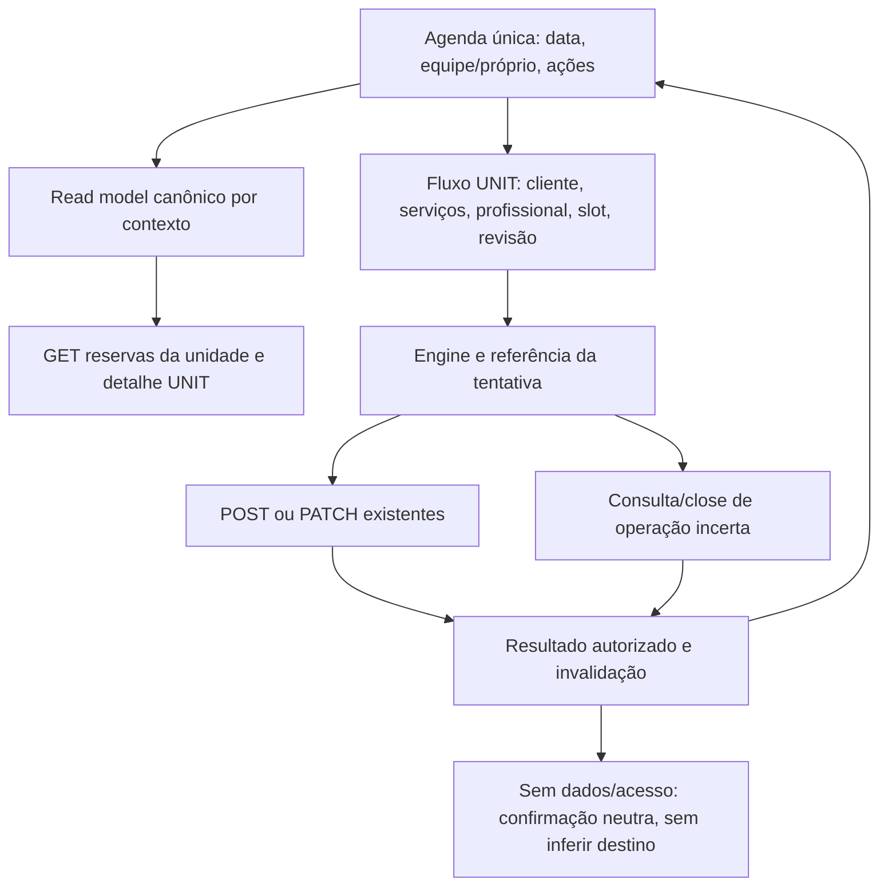

# Agenda unificada e criação operacional — plano de13/10/2026

**Estado: APPROVED — planejamento.** Escopo, abordagem e desenho principal aprovados pelo usuário; revisão técnica estruturada encerrada pelo árbitro, sem bloqueadores documentais. Handoff pronto. Não iniciar implementação sem pedido de execução; esta aprovação não prova código/runtime/produção.

## 1. Objetivo e decisões aprovadas

Uma única Agenda de trabalho deve reunir as funcionalidades úteis de Agenda e Atendimentos, com entrada visível para reservar vários serviços para um cliente cadastrado. Meus Agendamentos continua pessoal. Preservar design system, arquitetura, autoria das contribuições e regras de segurança.

| Decisão | Definição | Alternativa / razão |
| --- | --- | --- |
| D01 | Escopo: Agenda operacional + criação + correções essenciais dos consumidores afetados | Lacunas de equipe/admin/descoberta/geo permanecem registradas; usuário confirmou esse limite |
| D02 | Manter Agenda atual e incorporar ações de Atendimentos | Usar Atendimentos como base foi considerado; usuário escolheu preservar a Agenda |
| D03 | BARBERMAN vê a própria agenda; OWNER vê equipe e filtra profissional | Desenho explicitamente aprovado; papel é o vínculo na unidade, não accountType global |
| D04 | Criar/remarcar retorna à unidade e data correspondentes na Agenda | Desenho aprovado; operação UNIT não deve cair na lista pessoal do ator |
| D05 | Detalhe e ações acessíveis a partir de cada reserva; Novo agendamento visível | Desenho aprovado; preservar ações já existentes e remover entrada duplicada |
| D06 | Preservar regras já aprovadas: conta/CPF único, cliente cadastrado/verificado, vários serviços, prazos2h/início, ausência manual após15min | Não reabrir decisões de negócio sem conflito concreto |

**NFR propostos como decisões técnicas de execução:** leituras paginadas, um cache canônico por ator/unidade/papel/data/profissional/status; referência autoritativa de tempo; estados de erro/partial explícitos; CPF/e-mail de lookup só em memória; nenhuma alteração de reserva existente sem versão/chave; recuperação preservada após timeout/logout; nenhuma tela promete livre/receita/pagamento sem contrato. Web responsiva e native verificados separadamente. Manter referência atual60s de polling/staleTime, aviso lento5s, desatualizado5min e janela de calendário±90dias, sem otimização além da necessidade medida.

Precisão sobre comandos: criação não tem versão anterior. CREATE exige chave da tentativa, slot autoritativo e preço/duração efetivamente revisados; CANCEL/RESCHEDULE/COMPLETE/NO_SHOW exigem chave e expectedVersion da reserva existente, além da capacidade/contexto atuais. RESCHEDULE também envia preço/duração revisados. Esta definição prevalece sobre menções genéricas a “mutation com versão”.

## 2. Bases e análise obrigatória

- [Análise e matriz de todas as rotas](ANALISE_AGENDA_UNIFICADA_E_COBERTURA_API_2026-10-13.md).
- Frontend main7fd864c e branch28024c4 tinham src idêntico na auditoria. Backend main4249abd após PR51 e cópia1e2d880 tinham src idêntico. Revalidar HEADs antes de executar; não implementar sobre o checkout API antigo2d5ebd5.
- Aprovações recebidas nesta conversa: escopo delimitado; preservar Agenda como base; proprietário equipe/filtro, barbeiro próprio, ações e retorno corretos.
- 53 operações API canônicas auditadas;38documentadas no Swagger incluindo saúde/docs-json. Há17canônicas existentes não documentadas. A ausência no Swagger não autoriza recriar uma rota.
- POST /bookings PERSONAL e UNIT já consomem API; não criar outro POST de reserva. O problema UNIT é entrada, autorização contextual/retorno/estado e ausência de homologação vertical.

## 3. Desenho do produto

### Agenda de trabalho

Conservar calendário e timeline atuais; acrescentar contexto da unidade, filtro de profissional para OWNER, indicação de agenda própria para BARBERMAN, botão Novo agendamento e ações por reserva. Em equipe, cada card identifica o profissional quando houver nome real autorizado; atendimentos simultâneos de profissionais diferentes não são conflitos por si só. Não introduzir calendário de colunas/drag-and-drop nesta entrega.

Card abre o detalhe existente com scope UNIT. Remarcar abre o fluxo existente de remarcação. Cancelar/concluir/não compareceu usam os componentes e comandos compartilhados com capabilities atuais e confirmação. No mobile, evitar cinco botões grandes por card: detalhe oferece ações secundárias; o executor pode usar um menu acessível de ações mantendo os mesmos destinos/comportamento. No desktop, conservar a composição de resumo/timeline, sem novo segundo destino.

Atendimentos sai de sidebar/drawer/cápsula. A URL antiga /atendimentos permanece como redirecionamento para Agenda, sem executar queries/mutations próprias. Preservar somente contexto interno validado, nunca URL externa. Links de reservas pessoais continuam fora do destino de trabalho.

### Criação operacional

Agenda e ação rápida da home abrem /new-booking. Unidade e data vêm do contexto atual; profissional pré-selecionado é o filtro real do OWNER, ou o próprio BARBERMAN. Sem promessa de slot livre nesta entrada.

Fluxo: cliente existente por e-mail exato/CPF → serviços múltiplos → profissional elegível quando necessário → disponibilidade autoritativa → revisão com cliente/serviços/total/duração/prazos → confirmação explícita → resultado. Não criar cliente no lookup; não reservar automaticamente ao entrar, voltar do login ou selecionar horário. Conflito/orçamento alterado exige nova revisão.

A revisão de CREATE e RESCHEDULE deve mostrar também **unidade, profissional, data civil e intervalo de horário da unidade**, com fuso quando houver ambiguidade. O operador confirma o contexto efetivamente enviado, inclusive os valores herdados da Agenda/home. Remarcação identifica a reserva atual e o novo horário/quote. Dado essencial desconhecido impede confirmação; não fabricar nomes/horários.

Alterar/rebuscar o cliente invalida a seleção anterior e a revisão/confirmação ligadas a ela. Só aceitar o resultado autorizado da busca vigente; resposta atrasada não restaura cliente antigo. Cliente ausente/não verificado/503 mantém confirmação indisponível. Preservar somente outras seleções ainda válidas no mesmo contexto e nunca substituir beneficiário silenciosamente.

Sucesso UNIT oferece Ver na Agenda e Ver detalhes UNIT; retorna à unidade/data da reserva. PERSONAL conserva sua lista pessoal. Recuperação APPLIED segue a mesma regra do sucesso normal. Nova reserva precisa limpar cliente/serviços/slot/confirmação anteriores, preservando no máximo o contexto operacional válido. “Novo agendamento” não significa encaixe fora de jornada: todas as regras de disponibilidade continuam.

### Consultas e erros

Não mostrar lista vazia quando houve503/erro de contrato ou query. Serviços, profissionais, disponibilidade, lookup e reservas têm loading/erro/retry separados. Dados de outra data/unidade/papel não podem ser acionáveis como se fossem atuais. Histórico/cancelados continuam preservados, sem texto de exclusão física.

Para resultado incerto de criação/remarcação/cancelamento, usar mensagem específica da operação: “Ainda não conseguimos confirmar o resultado. Verifique o resultado antes de repetir esta ação.” A ação é **Verificar resultado**, ligada à mesma referência existente. Consultar não prepara/reenvia outro comando; não oferecer Fazer outro no estado incerto. Se permitir voltar, informar que a verificação está pendente e conservar a referência. APPLIED, inclusive redigido, segue o tratamento de retorno S01.

Lista paginada informa itens carregados e total, oferece Carregar mais quando hasNext autoritativo e não fabrica completude. Se faltarem metadados, mostrar lista parcial/erro contratual e impedir indicadores de lista completa. Não chamar gaps da timeline de livres. /availability só é consultada depois de serviços/profissional/data definidos.

## 4. Contratos existentes a reutilizar

| Operação | Uso nesta entrega |
| --- | --- |
| GET /api/users/me e /me/barbershops | Identidade/vínculo selecionado; diferenciar status da unidade e state do vínculo |
| GET /api/barbershops/:shopId | Metadados reais da unidade/fuso |
| GET /api/barbershops/:shopId/professionals | Profissionais ativos elegíveis e nomes reais para filtro/cards; não inventar nomes para IDs não encontrados |
| GET /api/barbershops/:shopId/services | Seleção de serviços existentes/ativos |
| GET /api/barbershops/:shopId/bookings | Fonte canônica de reservas operacionais, page/limit/hasNext/total/summary/serverTime |
| GET /api/bookings/:id?scope=UNIT | Detalhe/capabilities/version da reserva de trabalho |
| POST /api/barbershops/:shopId/customers/lookup | Cliente existente/verificado, critério exato, sem armazenar CPF/e-mail |
| GET /api/barbershops/:shopId/availability | Slots autoritativos por carrinho/profissional/data |
| POST /api/bookings | UNIT com customerId/shopId/serviceIds/barbermanId/slotStartAt/key e expectedTotalPriceInCents/expectedDurationInMinutes revisados; PERSONAL continua separado |
| PATCH /api/bookings/:id/reschedule | Mesma reserva, expectedVersion/key; serviços/profissional conforme papel |
| DELETE /api/bookings/:id/cancel | Cancelamento lógico, expectedVersion/key, confirmação |
| PATCH /api/bookings/:id/status | COMPLETED ou NO_SHOW, expectedVersion/key; nenhuma transição fictícia IN_SERVICE |
| GET /api/operation-attempts/:requestId e POST /close | Recuperação/fence existente; UNKNOWN/404/503 não autoriza preparar outra reserva sem a resolução prevista |
| GET /api/notifications e PATCH /:id/read | Avisos gerados pelo backend e navegação ao detalhe; sem reimplementar geração no frontend |

Não há necessidade identificada de endpoint novo de negócio para esta entrega. Se surgir lacuna impeditiva, documentar payload/resposta/teste e ajustar o contrato existente; não cobrir com mock/fallback. A atualização documental do Swagger não deve ampliar features.

## 5. Arquitetura e ownership

### Fonte de reservas e contexto

Criar/adaptar um read model canônico em features/bookings, consumido pela Agenda e pelos consumidores mínimos da home. Suggestão de arquivos novos: model/use-unit-bookings.ts e model/unit-bookings.types.ts. A assinatura recebe contexto autenticado explícito e filtros validados; nunca default-staff-id/unknown actor para habilitar fetch/ação.

Preservar BookingDto e a resposta paginada completos: id, unidade, profissional, beneficiário, serviços/snapshots, preço/duração, versão, status, startsAt/endsAt/timezone, capabilities e serverTime. Projeções visuais não devem descartar esses campos. Normalizar summary totalAmountInCents conforme adapter existente e hasIncompleteValues. Não somar preços parciais como totais exatos.

getOperationalContext deve falhar fechado para vínculo sem state ACTIVE, papel não autorizado ou unidade ausente. API active-only já tem normalização verificada em authApi; status ACTIVE da barbearia não substitui state ACTIVE. Não mudar sessão/cookies/refresh nem o modelo de identidade. Unidade INACTIVE não permite nova criação; leitura/histórico não devem ser apagados, respeitando a resposta autorizada do backend.

As keys incluem ator, unidade, papel, profissional, data civil, filtro/status e página. ROLE/profissional podem diferir para o mesmo accountType; queryKey não deve reutilizar dados de equipe para própria agenda. Ao mudar contexto, cancelar leituras antigas e impedir publicação tardia na tela nova. Manter a autoridade do servidor.

### Tempo e paginação

Dia civil da unidade vem de referência autoritativa serverClock + timezone real; a hora do dispositivo não decide prazo/ações/próximo atendimento. Campos date/startTime civis não devem ser reinterpretados como UTC. Calcular posição/ordenação temporal com startsAt quando disponível; legado sem instante não autoriza ação por reconstrução local fictícia. Não fabricar serverTime.

**Bootstrap temporal sem ciclo:** validar ator/vínculo e fuso; executar GET /barbershops/:shopId/bookings autorizado sem filtro date, com limit1 e o filtro profissional correto. A API existente fornece serverTime inclusive quando não há reservas. Essa resposta é apenas bootstrap, não resumo/agenda do dia; usar key própria, sincronizar serverClock e então determinar hoje/janela e consultar o dia. Enquanto clock/fuso não forem válidos, mostrar sincronização e bloquear ações temporais/“próximo”. Falha de bootstrap mostra retry, não usa Date.now como substituto.

O avanço monotônico deve desabilitar ações cujo deadline autoritativo expirou antes do próximo polling. Não habilitar capability antes negada só por cálculo local; refazer a leitura quando necessário. Na virada de dia, atualizar o hoje da unidade e a janela; só acompanhar a nova data automaticamente se o usuário estava seguindo Hoje, preservando datas escolhidas explicitamente.

**Validade da referência:** usar o serverClock existente com lease máximo de5min desde a sincronização aceita, medido pelo relógio monotônico. Ao vencer, invalidar referência para mutation/indicadores temporais e exigir sincronização nova. Logout/troca de ator/retorno de suspensão ou AppState/visibility para ativo exigem referência nova, independentemente do lease. Não criar segundo clock. Sincronizar somente após conferir geração/contexto e validar a resposta; atualmente adapters sincronizam antes do guard, então esse ponto precisa ser ajustado. Usar ordenação de requisições/amostras para impedir que resposta tardia recalibre uma referência mais nova. Leituras antigas podem terminar, mas não atualizar clock/cache/formulário do contexto vigente.

Usar paginação do backend com page/limit/hasNext/total reais e deduplicação por id. Primeira página sugerida20; incrementar página com Carregar mais, mantendo indicação de parcial. Toda mutation invalida as páginas carregadas do escopo. O “próximo atendimento” só pode ser declarado para o escopo completo carregado ou como informação explicitamente parcial; não apresentar “nenhum próximo” por ter carregado somente reservas passadas da primeira página.

**Geração da paginação:** polling/invalidação atualizam o conjunto carregado coerentemente, sem misturar páginas antigas e novas como se fossem uma consulta completa. Preferir substituição do conjunto após atualização das páginas carregadas, mantendo posição/estado visual; se houver metadados incompatíveis/falha, manter aviso de atualização/parcial ou reiniciar página1 explicitamente. Não invalidar e manter summary novo com itens de outra geração acionáveis. Toda consulta tem filtro/geração identificados. “Completo” significa páginas percorridas para o filtro naquela atualização do cliente; paginação offset não garante snapshot transacional do backend diante de alterações concorrentes. Exibir momento da atualização; disponibilidade/versão continuam validadas no servidor no comando.

### Comandos, ações e recuperação

Reutilizar bookingOperationEngine, OperationLifecycleBridge, BookingRecovery, BookingActionConfirm, BookingDetailView e fluxo de remarcação existente. Não criar motor, ledger, fila de retry, política de prazo ou storage novos. Uma chave pertence a um comando preparado; retry/reconciliação usam a mesma referência. Sem storage/clock/contexto, não enviar mutation; ações em reserva existente exigem também capability/version. Sem autoPOST após redirecionamento/retorno.

Para CREATE, version/capability de uma reserva ainda inexistente não são requisitos; valem contexto/slot/revisão e key. Tornar preço/duração esperados obrigatórios nos builders/comandos frontend de CREATE/RESCHEDULE, preservando compatibilidade do DTO HTTP onde necessário. Comparar quote recebida em QUOTE_CHANGED com a revisão anterior e exigir confirmação nova, sem reenvio automático. Nenhum erro de orçamento pode apagar a reserva anterior da remarcação.

Extrair somente utilitários puros de tempo necessários para shared/lib/civil-time.ts (ou local compartilhado equivalente existente), para evitar ciclo features/agenda→features/bookings→barrel de agenda. Port de leitura deve ficar abaixo da UI; Agenda não importa BookingsView/useBookingsViewModel para manter duas queries. Componentes podem reutilizar estilos/partes de cards e a contribuição do Pedro, sem manter a segunda autoridade de dados.

### Retorno e rascunho

Adicionar retorno tipado/whitelist para modos PERSONAL/UNIT: unidade, data, profissional e bookingId são contexto válido, não texto livre de redirect. Agenda aceita parâmetros validados e inicia no dia/profissional correto; BARBERMAN ignora filtro de colega. Unidade de destino deve existir nos vínculos atuais e estar autorizada para leitura.

Ao mudar unidade/papel/perder vínculo, limpar seleção/customerLookup e invalidar o slot/quote visível. Se existe tentativa pendente, manter a referência opaca e resolver seu resultado sob o ator original; não apagar nem mover para outra unidade. Resposta tardia do contexto anterior não preenche o formulário atual. Caso APPLIED pertença à unidade anterior, indicar a unidade real e só navegar quando o acesso atual autorizar; sem mudar silenciosamente a seleção global.

**Recuperação após expurgo/logout:** conservar na referência opaca somente originScope PERSONAL/UNIT validado, além das referências já permitidas; é pista de navegação, nunca autoridade de autorização. Ajuste mínimo dos schemas/whitelists do store existente, sem unidade/data/CPF/e-mail/snapshots sensíveis. Unidade/data do retorno devem vir do recurso definitivo autorizado/releitura. Referência antiga sem originScope não permite inferir o modo pelo papel global: apresentar resultado neutro e destinos escolhidos explicitamente entre os atualmente autorizados.

APPLIED com accessChanged e sem resource.data exibe “Operação aplicada; detalhes indisponíveis para esta conta”, preserva estado terminal e não oferece repetir/criar substituta no fluxo de recuperação. Sem dados definitivos não inventar unidade/data, não navegar automaticamente para Meus Agendamentos nem mudar a unidade. A tela pode voltar ao contexto atual autorizado, separado do resultado redigido. Testar UNIT→timeout→logout→login→APPLIED e APPLIED redigido.

## 6. Execução por grupos relacionados

### Grupo A — contexto, consultas e fonte única

**Ownership:** auth/model/operational-context.ts e testes afetados; bookings DTO/schema/keys/read model; agenda adapter/model; serverClock existente, aceitação de amostras/generation e lifecycle temporal; utilitários puros de tempo compartilhados.

**Ordem:** reproduzir regressões de contexto/role/cache/tempo/paginação → reutilizar contexto canônico estrito → DTO/read model paginado → projeção Agenda completa → alinhamento de keys e invalidações.

**Aceite:** nenhum fetch/mutation com ator/unidade artificiais; BARBERMAN próprio/OWNER equipe/filtro; mais de100reservas navegáveis; metadados/status/preço desconhecido fiéis; UTC vs São Paulo corretos; dados da unidade anterior não são acionáveis; zero duplicação de fontes de leitura.

### Grupo B — tela única, navegação e ações

**Ownership:** app/(app)/agenda.tsx e atendimentos.tsx; agenda/ui; partes reutilizáveis de bookings/ui; shared/navigation e tests; detalhe/remarcação comuns afetados.

**Ordem:** Agenda usa fonte A → filtro/CTA → detalhe/ações por capabilities → remover destino Atendimentos/redirect seguro → retirar modais/adapters/hooks legados de gestão somente após migrar todos os consumidores.

**Aceite:** somente Agenda na navegação; URL antiga abre Agenda sem efeitos; cards abrem UNIT; cancelar/remarcar/concluir/ausência conforme prazo/capability; erro/UNKNOWN/recovery visíveis; histórico mantido; confirmação não diz “excluir”; cliente pessoal não abre ações de equipe.

**Remover/adaptar:** BookingsView/useBookingsViewModel, EditBookingSheet, BookingCancelDialog e caminho antigo de agenda/dashboard somente quando realmente sem consumidor. Não apagar features/bookings inteiro, BookingFlowEngine/engine/op store ou Meus Agendamentos.

### Grupo C — criação operacional de ponta a ponta

**Ownership:** app/(app)/new-booking.tsx; use-booking-flow; CustomerLookup; BookingFlowView/Review/Result/Recovery; shared/operations types e whitelists web/native somente para originScope mínimo e testes de expurgo/legado; entrada/retorno da Agenda e action rápida da home.

**Ordem:** CTA para rota existente → argumentos/guard contexto → cliente/serviços/profissional → erros de leitura → revisão/POST → retorno UNIT/PERSONAL → reset e mudança de contexto → recovery APPLIED segue mesmo retorno.

**Aceite:** agenda→cliente cadastrado→dois serviços→slot→revisão→um POST real UNIT→mesma unidade/data; barbeiro só si/proprietário equipe; beneficiário distinto do ator; nenhum dado de CPF/e-mail em URL/storage/log; “Fazer outro” começa limpo; falha/quote_changed/retry não duplica; link pessoal mantém seu comportamento.

### Grupo D — home, contratos e homologação integrada

**Ownership:** dashboard read model/queries/actions mínimos; documentação de rotas necessárias; regressões/end-to-end e relatório de evidência.

**Ordem:** remover aviso falso de endpoint inexistente → eliminar DELETE sem key/version da home → usar fonte/ações comuns com unidade real → corrigir status/valores fabricados que afetam esse fluxo → validar jornada e links em desktop/mobile.

**Aceite:** home aponta Agenda/Novo agendamento e ações seguras; não força CONFIRMED/pagamento/receita recebida/indicadores zero. Valores de summary são rotulados como valores de reservas no filtro, não faturamento pago. Redesenho completo das homes/descoberta fica para grupo próprio.

Grupos A→B→C→D podem ser executados numa única branch e sequência por um executor, com checkpoints por grupo. Uma única execução mantém contexto e reduz retrabalho. Revisão independente do diff final é obrigatória, mas não transforma este plano em autorização de implementação ou merge.

## 7. Testes obrigatórios por risco

| Camada | Cenários que devem provar comportamento |
| --- | --- |
| Contexto/read model | roles divergentes do accountType, INACTIVE, state ausente, sem unidade, >100itens, hasNext/summary incompletos, preço nulo, UTC/São Paulo, próximo com página parcial, troca de ator/unidade |
| Tela/navegação real | um destino Agenda em drawer/sidebar/cápsula; redirect Atendimentos; abrir detalhe UNIT; filtro profissional OWNER; BARBER ignora colega; retorno ao dia correto; teclado/foco/44px, erro anunciado |
| Criação UNIT renderizada | entrada pela Agenda/home, lookup exato, e-mail não verificado/cliente ausente, dois serviços, seleção/erro de serviços e slots, revisão, POST único com beneficiário correto, reset, mudança de contexto |
| Ações | key e expectedVersion presentes, capabilities ausentes negam, remarcação PATCH mantém ID, deadlines2h/início, no-show15min manual, completed sem inventar pagamento,409preserva registro anterior |
| Recuperação | timeout após commit/503/404/UNKNOWN, mesma referência em reconciliação, APPLIED retorna UNIT, close/fence NOT_APPLIED, logout/troca de conta, storage indisponível zeroPOST |
| Cache/invalidação | reservas completas por escopo, disponibilidade, detalhe, home e notificações atualizam; requisição tardia não restaura outro contexto |
| HTTP/PG isolados | efetuar UNIT por BARBER e OWNER, dois serviços, conflitos/replay, remarcação/cancel/status e avisos persistidos; não alterar seed/dev/produção para esse teste |
| Plataforma | Chrome375/768/1024/1440 e tema claro/escuro; pelo menos execução Android/iOS para declarar native PASS. Sem ambiente: NOT TESTED com roteiro, nunca trocar por prova web |

Não aceitar somente mocks de adapters como prova da jornada UNIT. Testes devem renderizar rota/hook/componentes reais e executar fluxo no navegador com API/PG locais isolados. Não criar centenas de testes de cor/estilo que espelham implementação. Typecheck, suíte relevante/completa conforme scripts e export web finais são checks de build, separados da prova de produto.

Aceites adicionais da revisão S01–S03: bootstrap com relógio do aparelho incorreto e lista vazia; virada de dia/deadline sem novo HTTP; origem UNIT conservada após logout sem PII; APPLIED sem acesso/DTO não inventa resultado nem libera repetição; preço/duração alterados entre revisão e confirmação de CREATE e RESCHEDULE produzem QUOTE_CHANGED, nova revisão e zero reenvio automático.

Aceites C01–C02: respostas fora de ordem/troca de ator/suspensão não recalibram clock vigente; lease vencido5min bloqueia ação até sincronizar. Polling/invalidação/erro em página intermediária não mesclam gerações nem anunciam ausência/completude forte ou summary de outra consulta; preservar posição quando possível e qualificar paginação offset sob concorrência.

Aceites U01–U03: data/profissional herdados aparecem na revisão e correspondem ao POST/PATCH; busca A→B inválido/503 e resposta atrasadaA nunca mantém A como beneficiário; estado incerto usa Verificar resultado sem criar comando, conservando a referência ao sair/retornar e sem declarar falha definitiva após resposta perdida.

## 8. Fora desta entrega e registro de lacunas

Manter a matriz ampla como backlog. Equipe: GET team/PATCH desativação e convites enviados sem UI. Conta: logoutAll/changePassword sem tela. Jornada profissional: parâmetro disponível, UI geral apenas. Ativação profissional: chamada /barbers/activate sem backend. Descoberta pública e admin gerencial: sem endpoints. Notificação antiga por deep link: primeira página apenas. Geolocalização permanece em docs/backlog/geolocalizacao-barbearias.md. Não encobrir essas lacunas nem incluí-las automaticamente no PR da Agenda.

## 9. Release e entrega do executor

Usar branch/worktree neutra a partir da main atual, preservando alterações existentes; não continuar empilhando código numa branch já mergeada sem verificar a base. Não force-push em branches de Pedro/Jhon nem apagar histórico. API de negócio não muda por padrão; ajustes de Swagger existentes têm diff separado e não criam rotas.

O executor entrega: resumo por grupo, commits, lista de arquivos, testes/evidência com PASS/PARTIAL/FAIL/NOT TESTED, limitações por ambiente e PR proposto. Sem merge/deploy/migração/seed remoto nesta execução. Nenhum resultado desta etapa equivale a homologação de produção.

## 10. Revisão e decisão final

Skeptic → Constraint Guardian → User Advocate → Arbiter, sequencialmente conforme multi-agent-brainstorming. Registrar objeções, resolução e decisão explicitamente APPROVED/REVISE/REJECT. O plano não será apresentado como revisado/aprovado antes do parecer do árbitro.

**Parecer final recebido: APPROVED.** S01–S03, C01–C02 e U01–U03 foram aceitas, incorporadas e verificadas no plano/prompt/aceites pelo árbitro. Nenhuma objeção rejeitada, nenhuma decisão D01–D06 reaberta e nenhum bloqueador documental residual. Registro completo em REVISAO_AGENDA_UNIFICADA_2026-10-13.md.

### Decisões técnicas encerradas pela revisão

| Decisão | Alternativa considerada | Razão e resolução |
| --- | --- | --- |
| D07 / S01 | Inferir origem pelo papel ou armazenar payload sensível | originScope mínimo e recurso autorizado preservam navegação após logout; legado/redação têm resultado neutro |
| D08 / S02 | Usar o relógio do aparelho antes da sincronização | Bootstrap autorizado existente evita ciclo e data/prazos fictícios |
| D09 / S03 | Exigir versão de CREATE ou confiar em quote implícita | CREATE não tem versão anterior; quote esperada explícita fecha alteração entre revisão/confirmar |
| D10 / C01 | Referência temporal sem expiração ou amostra aceita antes do guard | Lease5min/lifecycle/generation/ordem mantêm autoridade temporal sem clock novo |
| D11 / C02 | Concatenar páginas de atualizações diferentes | Geração coerente/partial preservam a evidência real, sem promessa de snapshot SQL |
| D12 / U01 | Ocultar contexto herdado na revisão | Unidade/profissional/data/horário reais reduzem confirmação no contexto errado |
| D13 / U02 | Conservar cliente anterior após busca alterada | Seleção/revisão invalidada e resposta vigente evitam beneficiar pessoa errada |
| D14 / U03 | Tentar novamente/Fazer outro genéricos no estado incerto | Verificar resultado preserva referência e separa consulta de repetição |

Implementação, testes previstos e homologação continuam pendentes. A revisão aprovou o desenho, não executou nem aceitou entrega de código.
