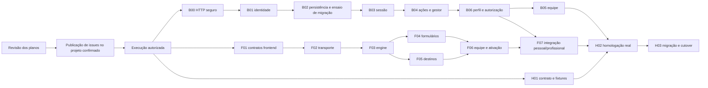

# Pacote de planejamento de autenticação

Data: 2026-10-03. Desenho aprovado e planos detalhados preparados. Publicação autorizada pelo usuário e realizada em quatro issues agrupadas, no Backlog do projeto Controle de Atividades. Implementação e homologação ainda não realizadas.

## Documentos e ordem de leitura

1. [Desenho aprovado e escopo](DESENHO_AUTENTICACAO_2026-10-03.md).
2. [Análise do código e decisões](ANALISE_AUTENTICACAO_E_DECISOES_2026-10-03.md).
3. [Contrato v1 para o desenvolvedor backend](CONTRATO_AUTENTICACAO_2026-10-03.md).
4. [Plano backend B00–B06](planos/2026-10-03-autenticacao-backend.md).
5. [Plano frontend F01–F07](planos/2026-10-03-autenticacao-frontend.md).
6. [Plano de contrato/homologação H01–H03](planos/2026-10-03-autenticacao-homologacao.md).

O pacote preserva a arquitetura e o cadastro OWNER pronto. Cliente entra pelo cadastro público; barbeiro é cadastrado por proprietário e ativa o acesso; CPF existente é a mesma conta. Gestor tem autenticação/área inicial, sem planos, métricas comerciais, MFA ou social. Futuras vagas/candidaturas permanecem fora desta entrega.

## Sequência e responsabilidades

B06 fornece AuthorizationService antes de B05; IDs das tarefas não impõem ordem numérica. F01/F02 avançam com fixtures, mas não há release frontend antes de backend v1/proxy/cookies compatíveis. H01 fornece fixture inicial antes dos testes de F01 e completa o ensaio HTTP depois de B05/B06. O diagrama representa dependências de entrega, não autorização para executar/paralelizar agora.

Responsáveis: backend — contratos, domínio, banco/migração, sessão/e-mail/gestor; frontend — jornadas, adaptação por plataforma, guards/cache/navegação; homologação — validação conjunta. Provedor/runner de e-mail e ambiente são dependências de execução reais, sem simulação declarada como integração.

## Issues publicadas por tipo de usuário

Projeto verificado: [Controle de Atividades — Backlog](https://github.com/orgs/Proj-Smart-Barber/projects/2). Todas as issues estão OPEN/Backlog, atribuídas a `wellingtonspdev` e `AlvaroSena`; os corpos separam front-end para Wellington e back-end para Álvaro. Títulos seguem `Sprint 3 - ...`, como as issues existentes, e a publicação foi feita no repositório API para manter o padrão de trabalho conjunto já usado na Sprint 3.

| Issue | Grupo | Responsabilidades |
| --- | --- | --- |
| [#32 — Login Unificado e Gestão de Sessões](https://github.com/Proj-Smart-Barber/api/issues/32) | Base comum a todos os tipos; OWNER preservado | Wellington: entrada/recuperação/roteamento/persistência. Álvaro: identidade, perfil autoritativo, sessão/tokens/segurança. |
| [#33 — Autenticação do Cliente](https://github.com/Proj-Smart-Barber/api/issues/33) | CLIENT | Wellington: cadastro/área/verificação/retorno ao catálogo. Álvaro: cadastro único, perfil, reservas próprias e autorização do titular. |
| [#34 — Cadastro e Autenticação do Barbeiro](https://github.com/Proj-Smart-Barber/api/issues/34) | BARBER, com cadastro iniciado por OWNER | Wellington: equipe/ativação/unidade/uso pessoal. Álvaro: cadastro pendente, transição da conta existente e vínculos por unidade. |
| [#35 — Autenticação do Administrador da Plataforma](https://github.com/Proj-Smart-Barber/api/issues/35) | PLATFORM_ADMIN | Wellington: área privada/destino/saída. Álvaro: provisão interna, perfil/permissões e sessão curta. |

As três issues de tipos dependem de #32. As issues #27–#30 existentes não foram alteradas; #34 somente as referencia para distinguir autenticação/vínculos de perfil/dashboard/agenda. Corpos publicados estão preservados em `docs/backlog/autenticacao-*.md`. Agrupamento em quatro issues substitui a proposta anterior de publicar cada tarefa isoladamente, conforme a instrução do usuário.

Verificação pós-publicação em 2026-10-03: `gh project item-list` e `gh issue view` confirmaram os quatro itens, ambos os responsáveis e status Backlog. Não houve implementação, commit, push ou deploy.

## Decomposição técnica de referência

Repositórios verificados pelos remotes locais: [API](https://github.com/Proj-Smart-Barber/api) e [frontend](https://github.com/Proj-Smart-Barber/Smart-Barber-frontend-mobile-web). Identificadores abaixo são locais e agora orientam as quatro issues acima; não foram criadas issues adicionais para cada tarefa.

| ID/título neutro | Repo | Prioridade | Depende de | Critério principal |
| --- | --- | --- | --- | --- |
| A00 — Proteger HTTP de autenticação e retirar manutenção pública | API | P0 | Contrato revisado | JWT inválido401, indisponibilidade503, manutenção404 e autoria/path protegidos. B00. |
| A01 — Definir identidade única por CPF e tipos de conta | API | P0 | A00 | Canonização, conflito seguro, OWNER preservado, auditoria legada. B01. |
| A02 — Persistir operações de identidade e preparar migração | API | P0 | A01 | UNIQUE real, transação/rollback, inventário e ensaio sem perda de IDs/FKs. B02. |
| A03 — Renovar e revogar sessões web e nativas | API | P0 | A02 | Cookie/transportes,30d/8h, concorrência, replay seguro e logout. B03. |
| A04 — Confirmar e-mail, recuperar acesso e provisionar gestor | API | P0 | A02,A03 | Tokens de finalidade/uso único, reset invalida links/sessões, outbox e gestor interno. B04. |
| A05 — Cadastrar barbeiros pelo proprietário e ativar vínculo | API | P0 | A02,A04,A06 | CLIENT→BARBER sem novo ID, corrida exige login, várias unidades/revogação. B05. |
| A06 — Autorizar perfil, unidade e recursos pessoais | API | P0 | A03,A04 | Perfil v1, scopes atuais, leitura própria, sem POST de reserva fictício. B06. |
| F01 — Integrar contrato de identidade no frontend | Frontend | P0 | Contrato/H01 fixture inicial | DTOs estritos/userId/tipos sem fallback inseguro. F01. |
| F02 — Persistir sessão com transporte web e nativo | Frontend | P0 | F01,A03 | Cookie/proxy e SecureStore; falhas explícitas. F02. |
| F03 — Coordenar engine e restauração da sessão | Frontend | P0 | F02,A03 | Saída vence requests tardios, offline/abas, cache limpo, errotemporário preservado. F03. |
| F04 — Cadastrar cliente e concluir confirmação/recuperação | Frontend | P0 | F03,A04 | OWNER intacto, cliente confirmado, links/retorno seguros, sem reserva falsa. F04. |
| F05 — Direcionar áreas e permissões por identidade | Frontend | P0 | F03,A06 | Cliente/admin/operação separados, unidade autorizada, BARBER sem vínculo. F05. |
| F06 — Gerenciar equipe e ativação profissional | Frontend | P0 | F04,F05,A05 | OWNER inicia; SET_PASSWORD→login; SIGN_IN→perfil; recusa/conta errada claras. F06. |
| F07 — Separar reservas pessoais e agenda profissional | Frontend | P1 | F05,F06,A06 | Titular/unidade nas consultas, status desconhecido preservado. F07. |
| H01 — Versionar contrato e validar HTTP com PostgreSQL de teste | API + Frontend | P0 | Contrato; HTTP final após A05,A06 | Fixture/OpenAPI v1, duas identidades/unidades, limites e concorrência. H01. |
| H02 — Homologar jornadas web, nativas e entrega de e-mail | Frontend, vinculada API | P0 | A05,A06,F07,H01 | Browser/device/recebido real; evidência por camada. H02. |
| H03 — Ensaiar migração e coordenar cutover | API, vinculada Frontend | P0 | H02 | Recuperação sem perda, janela legada fixa e desempenho documentado. H03. |

H01–H03 são critérios de validação do pacote nas issues agrupadas. Se for necessário abrir subtarefas durante execução, fazê-lo em etapa explicitamente autorizada; não duplicar o backlog recém-publicado.

## Formato de issue e condições de publicação

Cada issue terá: problema/comportamento esperado; escopo/exclusões; links do desenho/contrato e Task exata; arquivos/interfaces; dependências por URL; critérios de aceite; comandos/camadas de teste e evidências; limites de ambiente. Checkbox inicial aberta, sem indicar testes/implementação concluídos. Branch/commit/título neutros, sem nomes de ferramentas/agentes.

Ordem: revisar pacote com o usuário → validar acesso GitHub/organização/projeto → inventariar issues abertas para evitar duplicatas → preparar corpos completos → publicar/associar ao projeto quando autorizado. Aprovação do desenho não foi tratada como publicação imediata.

A primeira consulta read-only retornou `unknown owner type`; a inspeção posterior identificou falha de proxy da rede restrita. A consulta por execução autorizada confirmou a conta `wellingtonspdev`, o membro `AlvaroSena`, o projeto2 Controle de Atividades (`PVT_kwDOEuaDyM4BhWgN`) e o status Backlog (`f75ad846`). Ambos foram validados como assignees permitidos antes da criação. O problema de identificação foi resolvido sem alterar configuração permanente de proxy ou permissões do projeto.

Corpos multiline usam arquivo/argumento estruturado com newlines reais. As URLs de dependências serão preenchidas pelos resultados das criações autorizadas; se uma criação falhar, interromper dependentes e registrar quais foram efetivamente criadas. Não enviar este pacote por e-mail/chat ao desenvolvedor sem destinatário e autorização de envio; o contrato já constitui handoff revisável.

## Cobertura da especificação

| Requisito | Implementação | Evidência final |
| --- | --- | --- |
| Um CPF/uma conta/tipo único e legado seguro | B01/B02 | H01/H03 |
| Login único e destinos autoritativos | B03/B06,F01/F03/F05 | H01/H02 |
| Conta + e-mail confirmado para consumidor | B04/B06,F04 | H01/H02; POST real da reserva pertence à fase de agendamento |
| OWNER cadastro pronto/atende/consumidor | B01/B06,F04/F05/F07 | H01/H02 regressão OWNER |
| OWNER cadastra BARBER; cliente existente preservado | B05,F06 | H01/H02 concorrência/aceite |
| BARBER multiunidade/sem vínculo/consumidor | B05/B06,F05/F07 | H01/H02 |
| Gestor autentica, sem recursos comerciais agora | B04/B06,F05 | H01/H02 |
| Persistência/logout/offline/refresh | B02/B03,F02/F03 | H01/H02 cookies/SecureStore |
| Confirmação/recuperação e envio real | B04,F04 | H01/H02 provedor/runner |
| Segurança/riscos reais do código local | B00/B02/B06 | H01/H03 |
| Requisitos não funcionais e migração | B02/B03/B04,F02/F03 | H02/H03 |
| Social/MFA/planos/métricas/recrutamento futuros | Fora do pacote atual | Revisar diff/rotas conforme limites de todos os planos |

## Estado e revisão

Revisão especializada concluída com disposição **APPROVED para revisão humana dos planos**. Todas as objeções S1–S9/G1–G3/U1–U5 estão resolvidas no registro; nenhum teste de implementação/homologação foi executado. A autorrevisão conferiu cobertura, contratos de tipos, passos verificáveis, risco/caso de teste e proporção do plano, incluindo compatibilidade do envelope legado e ordem B06→B05.

- [x] Decisões e desenho aprovados pelo usuário.
- [x] Contrato e planos detalhados preparados.
- [x] Autorrevisão de cobertura/interfaces/passos realizada; conclusões da revisão especializada registradas na análise.
- [x] Usuário autorizou publicação e solicitou agrupamento por usuário com responsabilidades breves.
- [x] Projeto GitHub e campos reais confirmados.
- [x] Publicação de quatro issues autorizada, realizada e verificada no Backlog.
- [ ] Implementação executada/testada/homologada.

Os planos são o entregável desta etapa. Código funcional, banco, serviços e deploy permanecem sem execução. O método de implementação será escolhido após a revisão/publicação das issues conforme a sequência solicitada.
