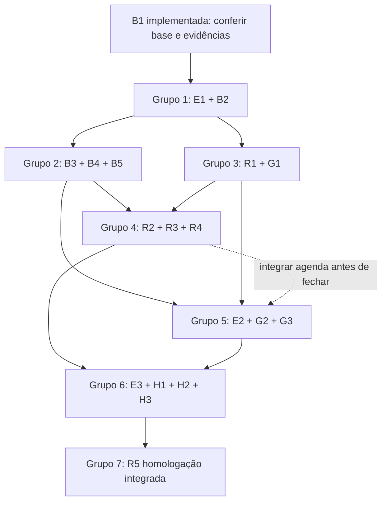

# Execução agrupada — agendamento, equipe e homes

Atualização solicitada pelo usuário após informar a conclusão da B1. Esta organização substitui a execução/revisão isolada de cada tarefa por **uma execução por grupo relacionado e uma revisão independente ao final do grupo**. Decisões D01–D16, testes e gates do plano aprovado continuam válidos.

## Base e nível de evidência

- B1: concluída segundo o usuário; implementação local encontrada na API em `c432b53` (`feat(bookings): persistir itens e historico de reservas`), branch `fix/cors-credentials-api`.
- Conferidos commit/arquivos, ports e teste `src/infra/drizzle/booking-items.integration.spec.ts`. A API oferece `createWithItems` e `getDetails`, além das portas legadas. O teste usa conexão Drizzle real; nesta reorganização não foi executado e seu alvo/resultados não foram revalidados.
- Não presumir que B1 já está em main/produção. A base dos próximos grupos deve conter `c432b53` ou seu equivalente integrado. Não partir de uma main que descarta essa entrega.
- Preservar migrations/compatibilidade da B1; verificar banco de testes antes de importar/iniciar testes ou servidor, pois o migrator ainda integra o boot da aplicação.
- Restam **18 tarefas originais**, distribuídas em **6 grupos de desenvolvimento + 1 grupo de homologação**. Nenhuma tarefa foi eliminada.
- Auditoria posterior de [rotas/Swagger](D:/smart_barber/Smart-Barber-frontend-mobile-web/docs/AUDITORIA_ROTAS_SWAGGER_API_2026-10-11.md):62operações registradas,29documentadas,13aliases staff. Grupo1 tem quatro endpoints realmente novos; os demais grupos reutilizam handlers existentes onde indicado. Criação operacional amplia POST /bookings, retirando POST paralelo de unidade. Verificar contratos reais, não decidir novidade só pelo Swagger.

## Como executar

Um executor mantém o contexto do grupo, executando as tarefas internas na ordem indicada. Pode fazer checkpoints/commits locais por unidade testável, mas não precisa trocar de agente/contexto a cada tarefa. Um revisor independente examina o diff inteiro, migrations, contratos e evidências ao final. Corrigir os achados antes de liberar dependentes.

Manter TDD/focused tests por tarefa; rodar a suíte/checks do repositório ao terminar o grupo e quando uma alteração/falha justificar repetição. Não repetir builds/suítes sem mudança relevante apenas porque começou outro item. Revisão por grupo não substitui testes dos casos definidos nos planos originais.

Se houver paralelismo, usar checkouts/worktrees separados e bases que incluam os grupos já aprovados. Um executor por grupo, ownership explícito e integração coordenada. Não compartilhar o mesmo diretório/schema de teste entre writers concorrentes. Não há autorização de implementação/publicação nesta reorganização.

## Grupos

| Grupo | Tarefas | Repositório | Entrega | Pré-requisitos |
| --- | --- | --- | --- | --- |
| 1 — Base transacional e operações recuperáveis | E1 + B2 | API | Vínculos/versionamento, lock comum e ledger/reconciliação/close | B1 presente e interfaces de sua entrega conferidas |
| 2 — Reservas e lifecycle completo | B3 + B4 + B5 | API | Criar, consultar, remarcar, cancelar, concluir/ausência, feed e contrato HTTP | Grupo1 aprovado |
| 3 — Base do frontend e recursos da conta | R1 + G1 | Frontend | Adapters/clock/attempt store e guards/session/recursos pessoais | Grupo1 aprovado; contrato final de reservas do grupo2 pode ser consumido inicialmente via fixtures versionadas |
| 4 — Carrinho, agendamento e agenda | R2 + R3 + R4 | Frontend | Reserva pessoal/rápida, retorno de login, recuperação, detalhe/history e ações | Grupos2 e3 aprovados |
| 5 — Gestão profissional ponta a ponta | E2 + G2 + G3 | API + frontend | Cadastro CPF, ativação/convite/retorno, equipe/jornada/desligamento | Grupos1/2/3 aprovados; fechamento de G2 com agenda/ações depende do grupo4 |
| 6 — Descoberta, homes e navegação | E3 + H1 + H2 + H3 | API + frontend | Lista pública, homes por perfil, menu/seletor e acessibilidade | Grupos4 e5 aprovados |
| 7 — Homologação integrada | R5 | Ambos + banco isolado | Prova ponta a ponta e regressão, pronta para revisão de release | Grupos1–6 integrados e aprovados |

### Grupo 1 — Base transacional e operações recuperáveis

**Por que juntos:** E1 e B2 alteram schema/repositories, estado/versão de vínculos e infraestrutura transacional usada por todas as mutations. Agrupar fecha a dependência interna da desativação idempotente numa única execução.

**Ordem interna:** verificar B1 → parte estrutural E1 (ACTIVE/INACTIVE/version, listagem e port de locks) → B2 (ledger genérico, GET/close/fence e resultados discriminados) → finalizar E1 ligando desativação ao ledger e testar recuperação.

**Ownership:** schema/migrations/repositories de membership/operações, `professional-membership-unit-of-work`, handlers/factories/rotas E1/B2 e testes correspondentes. Este grupo define o contrato compartilhado consumido pelos grupos2/3/5; nenhum deles cria outra autoridade de locks ou outro storage/ledger equivalente.

**Aceite:** vínculo/version/listagem corretos; reservas futuras/em andamento e legado bloqueiam desativação; clock PG apóslocks; owner de outra unidade negado; original tardia após close não aplica; replay não duplica efeito; APPLIED sem acesso não vaza DTO; teste PG de corrida com comando controlado. A integração da corrida com POST real será fechada no grupo2, não declarada testada antecipadamente.

**Saída:** commit/base + interfaces/exemplos versionados de membership, operations, locks/clock e instrução do ambiente de teste. Próximo prompt: [grupo1](D:/smart_barber/Smart-Barber-frontend-mobile-web/docs/PROMPT_EXECUCAO_GRUPO_1_AGENDAMENTO_2026-10-11.md).

### Grupo 2 — Reservas e lifecycle completo

**Prompt atualizado após a entrega do Grupo1:** [executar Grupo2](D:/smart_barber/Smart-Barber-frontend-mobile-web/docs/PROMPT_EXECUCAO_GRUPO_2_AGENDAMENTO_2026-10-11.md). O relatório recebido informa263testes/revisãoAPPROVE, não reexecutados nesta preparação. A leitura local encontrou callback de desativação com transação própria dentro do ledger, replay/consulta/close sem revalidação de acesso, janelaUUIDv7 não aplicada e fallback de relógio local. O checkpoint inicial do Grupo2 deve confirmar/corrigir essas dependências antes de integrar reservas; o relatório anterior não substitui essa prova.

**Por que juntos:** B3/B4 compartilham política de autorização, slot, orçamento, status/versão, transação e notificações; B5 valida/publica a representação contratual de tudo isso. Evita repetir ajustes de DTO/Swagger e revalidar a mesma base em três execuções.

**Ordem interna:** criação pessoal/operacional e lookup protegido → consultas/agenda/resumo/paginação → cancelamento/remarcação/conclusão/ausência → materialização do feed → testes HTTP/PG/compatibilidade e Swagger B5.

**Ownership:** use cases/controllers/factories de reservas, policy, writers de preço/serviço/jornada/exceções, lookup limiter/redaction, agenda/detalhes, notificações e Swagger. Usar a infraestrutura do grupo1; mapear mudança de schema antes de gerar migration, preservando B1/E1/B2.

**Reuso obrigatório:** POST /bookings pessoal/UNIT no mesmo endpoint; me/detalhe/cancel existentes; disponibilidade/profissionais/jornada existentes. Corrigir disponibilidade que usa InMemoryBookingsRepository e writer do POST agregado; cancel não pode usar delete físico que apaga histórico. Completar Swagger/docs-json e serializers sem URLs duplicadas.

**Aceite:** vários snapshots reais, soma autoritativa, cliente beneficiário distinto do ator quando operacional, conflito inclusive cross-unit e desativação concorrente pelo endpoint real; prazos exatos; remarcação preserva original na falha; quote atual para revisão; feed transacional; >20itens com resumo do escopo inteiro; contratos legados seguros.

**Saída:** contratos reais/fixtures para reservas/agenda/actions/quote, endpoints e exemplos de erro, prova HTTP/PG. Este é o gate para o grupo4 sair de fixtures e confirmar reservas reais.

### Grupo 3 — Base do frontend e recursos da conta

**Prompt após a entrega relatada do Grupo2:** [executar Grupo3](D:/smart_barber/Smart-Barber-frontend-mobile-web/docs/PROMPT_EXECUCAO_GRUPO_3_AGENDAMENTO_2026-10-12.md). Preparado em12/10 com leitura estática dos contratos locais, sem reexecução dos testes do relatório recebido. Confirmar envelopes reais, metadata ausente e capabilities antes de integrar; lacunas indispensáveis voltam ao responsável Grupo2 e não podem ser encobertas por dados fabricados no frontend.

**Por que juntos:** R1 e G1 compartilham sessão, actorId, capabilities, retorno de autenticação e a ponte de lifecycle do storage de operações. Resolver juntos evita implementar o storage e corrigir logo depois como logout/troca de conta o usa.

**Ordem interna:** DTOs/ports/clock/entropy e shared operations → referências/payloads e ponte no root → recursos de conta/guards → refreshIdentity e seleção de vínculo ACTIVE → regressão login/reload/logout/convites.

**Ownership:** shared operations, adapters/parsers de bookings, helper de clock/UUID, session/guards/refreshIdentity, rotas comuns de conta e invitation-response. Entregar interfaces estáveis para grupos4/5, evitando imports circulares auth↔features e helpers indevidamente registrados como rotas.

**Aceite:** UUID timestamp correto; ausência de clock/entropy/storage bloqueia envio; referências incertas sobrevivem logout para o ator correto; outra conta não vê; CLIENT abre convites/notificações sem unidade; aceite atualiza engine autoritativo; unidade/papel inválido falha fechado; proxy/cookie e armazenamento de credenciais preservados.

**Saída:** core frontend com testes, APIs/keys/capabilities definidas. Pode desenvolver em paralelo ao grupo2 com fixtures/exemplos acordados. Ajuste final ao contrato real do grupo2 é obrigatório antes de declarar integração de reservas ou iniciar o aceite do grupo4.

### Grupo 4 — Carrinho, agendamento e agenda

**Por que juntos:** R2/R3/R4 usam a mesma jornada, estado de tentativa, BookingDto, revisão/actions e invalidações. A reserva só fica completa quando aparece corretamente em agenda/detalhe/notificação.

**Ordem interna:** catálogo/carrinho/slots/revisão → retorno de login/verify → criação pessoal e operacional → resultado incerto/close → consultas/paginação/detalhe → remarcação/cancelamento/status/cache.

**Ownership:** features services/bookings/agenda, adapters de dashboard afetados pelos DTOs, booking-return-intent e rotas de reserva/detalhe. Não mudar unilateralmente o shared operations/guard definido no grupo3; adaptar contrato com o responsável da integração e repetir checks afetados.

**Aceite:** carrinho chega a um POST real; login conserva seleção sem autoPOST; BARBER agenda a si e OWNER à equipe; dados/ações por unidade; CPF/e-mail de lookup não persistem; preço/slot/versão têm erros distintos; resultado perdido não cria outra operação; histórico/valores/status fiéis e cache isolado.

**Saída:** jornadas operacionais/pessoais e rotas públicas/account registradas, callbacks de abrir agenda/detalhe/remarcar para gestão de equipe e homes. Confirmar esses contratos de navegação antes do fechamento de G2 no grupo5.

### Grupo 5 — Gestão profissional ponta a ponta

**Por que juntos:** E2 entrega exatamente a identificação/ativação/convites consumidos por G3; G2 usa vínculos/desativação do grupo1 e agenda/lifecycle do grupo4. Uma execução vertical fecha o cadastro/conversão e seu uso na equipe.

**Ordem interna:** backend E2 com identidade única/reconvite → adapters/formulário/ativação/convites G3 → listagem/detalhe/jornada/desligamento G2 → aceite e refresh de sessão já entregue no grupo3 → regressões HTTP/browser.

**Ownership:** API invitations/barberRegistrations/ativação e fixtures/migrations desse domínio; frontend team/invitations/activate-barber e adapters. Não reimplementar ledger/session/agenda. Preservar o mecanismo de identidade D05 anterior.

**Aceite:** mesma conta/CPF; conflito não vaza identidade; senha existente não muda; retorno só após novo aceite; owner atua na unidade selecionada; futuro/em andamento bloqueia desligamento; lost response de cadastro/vínculo resolve sem duplicidade; acesso/menus atualizam depois da leitura autoritativa.

**Paralelismo condicionado:** E2/G3 podem avançar enquanto o grupo4 implementa as rotas/actions de reservas, com contratos estáveis do grupo3 e checkouts separados. Não fechar o grupo5 até integrar G2 à entrega real do grupo4. Se houver um único executor, concluir grupo4 antes de executar todo o grupo5 é a sequência mais simples.

### Grupo 6 — Descoberta, homes e navegação

**Por que juntos:** E3 fornece a listagem usada pela home CLIENT; H1/H2/H3 organizam entradas/menus por perfil e unem as entregas anteriores numa experiência navegável. Inclui uma mudança pequena no backend junto à integração visual, não uma reabertura do lifecycle.

**Ordem interna:** listagem pública E3 → home/descoberta cliente H1 → dashboard BARBER/OWNER H2 → navegação/capabilities/seletor/deep links e acessibilidade H3.

**Ownership:** API listagem pública/Swagger correspondente; frontend discovery, home-client, dashboard e shared navigation/layouts. Integrar entradas de reservas/equipe/conta já prontas. Aqui ocorre a revisão conjunta dos destinos visíveis e do uso no mobile/desktop.

**Aceite:** cliente inicia reserva pela busca; profissionais têm ação rápida; OWNER alterna equipe/minha agenda; nenhum status/nome/pagamento/zero falso; erro503 mostra retry/desatualização; páginas reais/links válidos; navbar não cobre conteúdo; temas/teclado/leitor. Geolocalização continua no backlog, sem distância inventada.

### Grupo 7 — Homologação integrada

R5 fica separado para testar o produto integrado, não apenas repetir a soma dos testes locais de cada executor. O executor de homologação/revisor usa a base integrada e cenário reproduzível com API/PG isolados.

Verificar todos os perfis, carrinho múltiplo, lookup/criação para outro cliente, conflito cross-unit, prazos, remarcação/rollback, quote_changed, response-loss/close/24h/logout, feed, conversão CPF/retorno, desligamento, navegação/homes, preservação login/cookies e evidência por web/Android/iOS. Correções retornam ao grupo proprietário do módulo, sem ampliar produto.

**Saída:** PASS/PARTIAL/FAIL/NOT TESTED por contrato/plataforma, revisão integrada final, limitações e roteiro de release. Não declarar produção homologada ou platform coverage por um teste web. Push/merge/migração/deploy dependem de autorização própria.

## Dependências e paralelismo

Paralelismo seguro imediato depois de grupo1: **grupo2 backend + grupo3 frontend**. Grupos4/5 só em paralelo com ownership/checkouts e gate da agenda descritos acima. Rotas/schema/migrator/contratos e root/shared frontend têm integrador definido; não executar dois writers na mesma cópia. Banco PG de testes independente por execução.

## Referências obrigatórias

- [Plano/spec global](D:/smart_barber/Smart-Barber-frontend-mobile-web/docs/PLANO_AGENDAMENTO_EQUIPE_E_HOMES_2026-10-11.md) e [desenho](D:/smart_barber/Smart-Barber-frontend-mobile-web/docs/DESENHO_AGENDAMENTO_EQUIPE_E_HOMES_2026-10-11.md).
- [Reservas backend B](D:/smart_barber/Smart-Barber-frontend-mobile-web/docs/planos/2026-10-11-reservas-backend.md).
- [Equipe/descoberta backend E](D:/smart_barber/Smart-Barber-frontend-mobile-web/docs/planos/2026-10-11-equipe-descoberta-backend.md).
- [Reservas frontend R](D:/smart_barber/Smart-Barber-frontend-mobile-web/docs/planos/2026-10-11-reservas-frontend.md).
- [Equipe/conta frontend G](D:/smart_barber/Smart-Barber-frontend-mobile-web/docs/planos/2026-10-11-equipe-conta-frontend.md).
- [Homes frontend H](D:/smart_barber/Smart-Barber-frontend-mobile-web/docs/planos/2026-10-11-homes-descoberta-frontend.md).

As tarefas/checklists originais continuam como especificação detalhada. Se houver divergência de método/ordem, esta organização mais recente prevalece; critérios de negócio/aceite não são relaxados. Não solicitar nova aprovação do mesmo escopo por causa do agrupamento.
