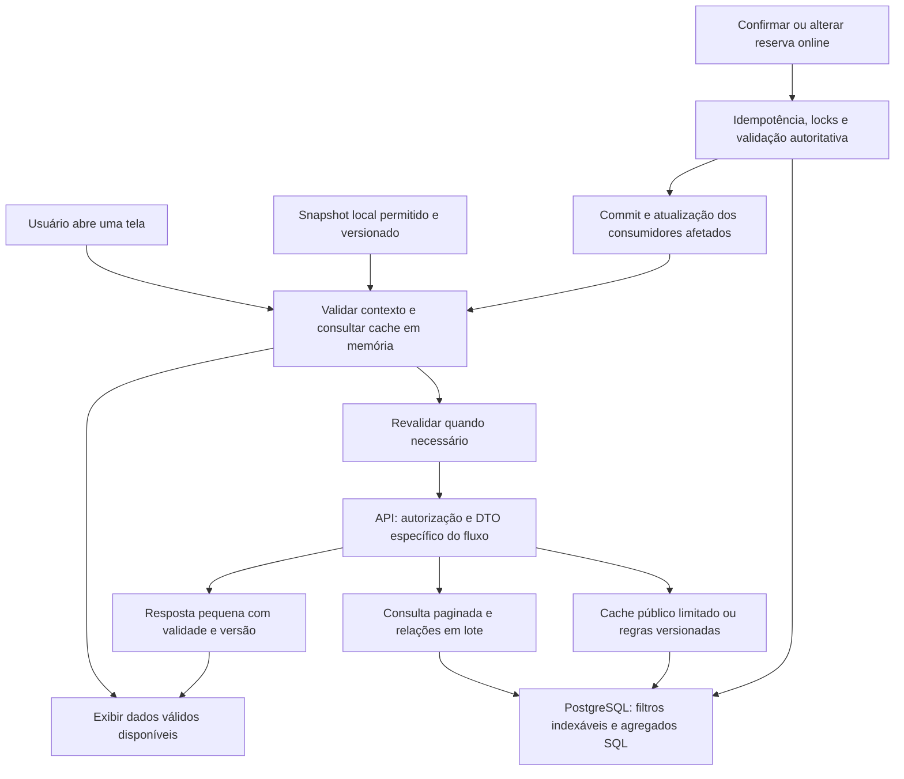

# Plano de otimização de respostas e experiência de carregamento

Data: 11/11/2026. Base: [auditoria e fontes](ANALISE.md). Estado histórico: **planejamento inicial**. Implementação local e checks automatizados concluídos; aceites manuais/visuais com o responsável. Consulte [execução](EXECUCAO_OTIMIZACAO_2026-11-11.md).

Objetivo: reduzir espera para visualizar dados e concluir agendamentos, com menos consultas, menos bytes e reaproveitamento seguro de informações. Preservar autorização, isolamento por unidade, preço, horário, idempotência e regras de concorrência.

## 1. Decisões propostas

1. Priorizar agenda, dashboard, disponibilidade e confirmação de agendamento. Financeiro e descoberta entram no mesmo programa, com entregas próprias.
2. Eliminar N+1 e agregações em memória antes de introduzir infraestrutura de cache compartilhado.
3. Corrigir invalidação e identidade das chaves antes de aumentar TTL ou persistir dados.
4. Reutilizar TanStack Query e caches já existentes. Não criar uma segunda camada independente de estado remoto no app.
5. Persistir inicialmente apenas conteúdo público selecionado. Offline pessoal e operacional exigem contrato adicional de identidade e privacidade.
6. Manter disponibilidade e operações de escrita autoritativas online. Cache de regras semanais pode existir sem tornar slots uma promessa de reserva.
7. Medir índices no PostgreSQL da versão efetiva; não aplicar uma lista genérica de índices.
8. Preservar o design e as versões de SDK de cada base de execução. Este programa não inclui redesign ou upgrade de Expo.

As alterações ocorrerão nos repositórios responsáveis: backend em `api`, frontend no repositório universal. Esta documentação fica reunida no frontend para revisão. Antes de executar, abrir bases limpas a partir da main acordada e comparar alterações pendentes dos worktrees. Não copiar arquivos da main sobre a árvore suja atual.

## 2. Arquitetura desejada

O caminho de escrita continua validando diretamente o estado atual. O resultado de uma leitura em cache não autoriza a operação.

## 3. Medição e critérios de sucesso

### Coleta comum a todas as entregas

Para cada fluxo, registrar mesmo conjunto de dados e perfil de rede antes/depois:

- Identificador de build, commit, ambiente e versão PostgreSQL.
- Cenário frio/quente; número de usuários simultâneos e distribuição por unidade/profissional.
- p50/p95/p99 do HTTP; SQL total, quantidade de comandos, aquisição de conexão e espera por lock.
- Linhas lidas/retornadas, buffers, sort/temp e tamanho JSON comprimido/descomprimido.
- Tempo até conteúdo útil, quantidade de chamadas por navegação, bytes de mídia e falhas/retries.
- Tempo entre commit de uma alteração e atualização do consumidor, além da validade do conteúdo exibido.

Não registrar payloads pessoais, tokens, cookies, coordenadas precisas, URL assinada ou argumentos SQL sensíveis. Usar IDs de correlação aleatórios, nomes de rotas parametrizados e query fingerprints. `pg_stat_statements` é evidência agregada; não fornece, sozinho, p95 por requisição ou causalidade de cada trace.

### Metas iniciais para calibrar na fase 0

| Indicador | Meta experimental | Condição |
|---|---|---|
| Consulta de 20 reservas operacionais | até 8 comandos SQL incluindo auth/vínculo, sem crescimento por item | Comparar páginas de 1, 20 e 100; legado também em lote |
| Bootstrap temporal | não ler histórico nem calcular resumo completo | Contexto de unidade e relógio devem continuar autoritativos |
| Leitura operacional e resumo, API quente | p95 até 400 ms | Carga e região definidas na baseline; não incluir mídia |
| Disponibilidade, API quente | p95 até 500 ms | Mesmo profissional/dia e concorrência representativa |
| Escrita de agendamento, API quente | p95 até 800 ms sem contenção; contenção medida à parte | Nenhuma dupla reserva e mesmo contrato de replay |
| Retorno a tela com cache válido | conteúdo útil em até 300 ms após contexto estar validado | Não contar login/restauração da sessão nesse indicador |
| Primeiro conteúdo público em rede limitada | p95 até 2,5 s após iniciar navegação | Perfil de 1,6 Mbit/s e 150 ms RTT; medir mídia inicial incluída |
| Volume de listagens | O(tamanho da página) | Resumo agregado não deve transportar o histórico para a API |
| Atualização após mutation local | consumidor atualizado ao concluir reconciliação da resposta | Sem esperar o TTL para atualizar preço, slot, total ou estado |
| Isolamento | zero conteúdo de ator/unidade anterior | Inclui memória, disco, abas e requisições em andamento |

As metas não são resultados obtidos. Se o ambiente inviabilizar um teto, documentar causa e renegociar orçamento antes do aceite. A exigência estrutural de consultas constantes e correção funcional permanece.

## 4. Fase 0 — Baseline e ambiente de prova

Dependências: nenhuma. Prioridade: primeira entrega. Complexidade: média.

**T00 — Fixar escopo e observabilidade**

- Confirmar commit realmente implantado, região API/banco/storage, versão PostgreSQL, limites do provedor, pool e compressão efetiva. Usar acesso autorizado; esta auditoria não acessou produção.
- Criar banco descartável exclusivo, usuário e configuração explícitos para benchmarks futuros. Recusar execução se host/schema não forem o alvo esperado.
- Construir dados sintéticos com unidades pequenas e grandes, vários profissionais, histórico moderno/legado, reservas concorrentes, serviços e exceções. Nenhuma cópia de dados pessoais.
- Usar escalas progressivas, por exemplo 10 mil, 100 mil e 1 milhão de reservas **no ambiente descartável**, respeitando capacidade. Os números são cenários, não volumetria atual estimada.
- Separar catálogo de poucas lojas do cenário com milhares. Medir tendência de crescimento e não só a fixture mínima.
- Instrumentar transporte frontend, adapter HTTP da API e camada DB com tempos e contagem de consultas. Produzir HAR/trace sanitizado e planos SQL sem dados de clientes.

**Arquivos/áreas:** `src/shared/api/http-client.ts`, hooks principais; API `src/core/infra/adapters/express-route-adapter.ts`, cliente Drizzle e middleware de métricas dedicado. Instrumentação será proposta e testada antes de habilitação fora do ambiente isolado.

**Aceite:** tabela antes/depois reproduzível por fluxo; decomposição rede/API/SQL/renderização; versão e índices efetivos inventariados. Nenhum teste usa banco compartilhado por fallback de `.env`.

O [SQL de diagnóstico](diagnostico-postgresql.sql) auxilia inventário futuro. Ele não foi executado. Instalar extensão, mudar parâmetros e executar carga não fazem parte da mera leitura desse arquivo.

## 5. Fase 1 — Leituras de reservas, agenda e dashboard

Dependências: fase 0. Prioridade: P1. Complexidade: alta. Achados: A01, A02, A04 e A14.

**T01 — Detalhes em lote**

- Criar leitura de página com projeção explícita de reserva, cliente autorizado, profissional e unidade.
- Buscar itens de todos os IDs da página em um lote; evitar multiplicação de linhas de paginação por join 1:N.
- Paginar reservas **antes** de juntar/agregar itens; contagem e resumo não podem contar serviços como se fossem reservas.
- Implementar fallback legado em lote para carrinhos e snapshots. Preservar `null` em preço desconhecido.
- Compartilhar implementação entre lista operacional, agenda detalhada e lista pessoal, mantendo projeções de autorização distintas.
- Detalhe individual pode continuar endpoint próprio; não obrigar a lista a carregar campos que só o detalhe utiliza.

**T02 — Resumo SQL e bootstrap leve**

- Substituir `summaryRows` e loops por `COUNT`, `SUM`, condição de dados incompletos e agrupamento por status.
- Preservar semântica atual dos valores das reservas; não convertê-los em “receita recebida”.
- Manter resumo global do filtro junto à primeira página quando útil. Nas demais páginas, suportar exclusão do resumo sem quebrar clientes antigos.
- Resolver data civil padrão no servidor ou fornecer contexto temporal dedicado leve. Remover a consulta ao histórico feita apenas para sincronizar relógio.
- Garantir coerência entre resumo e itens segundo um contrato definido. Uma transação de leitura curta ou revisão de snapshot pode ser usada; não manter transação aberta entre requisições de páginas.

**T03 — Paginação pessoal e datas**

- Introduzir ordenação total por campo temporal e ID. Definir explicitamente ordenação de valores nulos.
- Unificar registros modernos e legados com deduplicação; não esperar a página moderna ficar vazia para incluir legado.
- Acrescentar filtros de futuros/passados de forma compatível; migrar cliente para cursor quando fizer sentido. Versionar contrato se a semântica mudar.
- Reescrever filtros temporais com limites `[início, próximo início)` no fuso da unidade. Separar legado somente após testes de equivalência; não mudar a data de negócio incidentalmente.

**Arquivos/áreas:** API `drizzle-bookings-repository.ts`, porta `bookings-repository.ts`, controllers de listagem pessoal/unidade e testes de contrato. Frontend `use-unit-bookings.ts`, `use-my-bookings.ts`, DTOs/adapters e viewmodels de agenda/dashboard.

**Aceite:** número de consultas limitado ao orçamento e independente de N; resumo idêntico ao resultado de referência; mesma autorização por papel; nenhuma perda/duplicação ao paginar cenário definido; bootstrap sem varredura de histórico. Testes de histórico misto, horários nulos, virada de dia, filtros e ausência de preços.

**Rollback:** manter contrato anterior durante transição; ativar leitura nova por flag no servidor. Reverter leitura sem remover colunas ou dados. Invalidar cache de DTO se formato mudar.

## 6. Fase 2 — Disponibilidade e escrita de agendamento

Dependências: fase 0; reuso da fase 1 quando aplicável. Prioridade: P1. Complexidade: alta. Achados: A03–A06 e A11.

**T04 — Leitura de disponibilidade por escopo**

- Consultar jornada do dia geral e individual, estados de escopo e exceções da data em consultas limitadas.
- Preservar as regras de herança, ausência, fechamento e exceções gerais/individuais do `EffectiveScheduleResolver`.
- Buscar ocupação mínima do profissional e intervalo necessário. Manter conflito global do profissional entre unidades.
- Paralelizar metadados independentes fora de regiões críticas quando seguro. Evitar usar conexões paralelas dentro de uma única transação por hábito.
- Preparar cache interno apenas para regras semanais e metadados versionados, invalidado por mudanças de jornada/escopo/exceção/serviço/equipe. Começar sem cache de resposta de slots.
- Ordenar/deduplicar IDs de serviço na chave de leitura, preservando a rejeição de entradas inválidas na API e a semântica do comando de escrita.

**T05 — Menos trabalho na transação, mesma correção**

- Substituir leitura individual de serviços por lote; conferir o que deve ser revalidado dentro da transação.
- Medir tempo de cada lock e comando; reduzir hidratações desnecessárias na região crítica.
- Manter ordem de aquisição, versão, fingerprint, request ID, relógio pós-lock, revalidação do slot e atomicidade de reserva/itens/eventos/notificações.
- Alteração de granularidade de lock só entra se a espera por lock for relevante e houver modelo de concorrência completo. Não remover lock da unidade na mesma entrega de query tuning.
- Não acrescentar cache de autorização global ou TTL de disponibilidade que aceite confirmação com dado desatualizado.

**T06 — Atualização controlada no cliente**

- Polling apenas quando a etapa estiver ativa, tela em foco, app em primeiro plano e conectado.
- Medir necessidade de 15 s; usar jitter e backoff de falhas sem atrasar revalidação antes de confirmar.
- Em retomada, bloquear seleção inválida até revalidar conforme contrato atual. Exibir atualização sem substituir todo conteúdo por spinner.
- Timeout/cancelamento de escrita mantém tentativa incerta e reconciliação pela chave original. Retry automático de GET não deve vazar para mutations.

**Arquivos/áreas:** caso de uso de disponibilidade; repositórios/portas de schedules, scope e exceptions; criação/reagendamento/cancelamento/status; `drizzle-professional-membership-unit-of-work.ts`; frontend `use-booking-flow.ts`, `use-booking-availability.ts`, engine de operações e relógio.

**Aceite obrigatório:** disputa simultânea pelo mesmo slot confirma no máximo uma reserva; replay retorna o resultado original; profissional em duas unidades não ganha sobreposição; concorrência com alteração de jornada/serviço/equipe conserva política atual. Incluir timeout após commit, alteração de preço, fuso, meia-noite e retomada de app. Ganho de latência deve ser acompanhado de duração/espera da transação.

**Rollback:** desabilitar cache interno e caminho de leitura novo. Preservar tentativas e dados confirmados; não desfazer reserva para restaurar cache.

## 7. Fase 3 — Índices e operação PostgreSQL

Dependências: SQL final das fases 1–2 e baseline. Prioridade: P1 seletiva. Complexidade: média/alta.

**T07 — Validar candidatos, um por hipótese**

1. Inventariar `pg_indexes`, `pg_index`, constraints e índices inválidos no ambiente alvo autorizado.
2. Capturar SELECT exato parametrizado e distribuição representativa. Considerar os caminhos sem profissional, com profissional, status e legado.
3. Medir `EXPLAIN (ANALYZE, BUFFERS, FORMAT JSON)` apenas em SELECT inspecionado no banco isolado. Não executar DML de negócio com ANALYZE.
4. Testar candidato do inventário da análise. Comparar tempo, buffers, linhas descartadas, memória/sort, tamanho do índice e custo de escrita.
5. Retestar carga mista de leitura/criação/reagendamento. Índice que acelera lista mas piora escrita/contenção pode ser rejeitado.
6. Aprovar somente índices que acrescentem benefício ao conjunto existente. Remoção de índice anterior é tarefa separada com dependências e uso verificados.

**Primeiros candidatos:** jornada por unidade/profissional/dia; exceção por unidade/data/profissional; notificação por usuário/criação/ID e não lidas; cliente/starts_at/ID; membership iniciando por usuário se login justificar. O composto operacional com profissional entra conforme frequência/seleção real. Índices textuais/espaciais dependem da fase 5.

**T08 — Migration e manutenção com evidência**

- Guardar DDL na API e atualizar schema/registro de migrations conforme mecanismo de release escolhido.
- Para tabela grande no ambiente compartilhado, planejar criação concorrente quando suportada. Ela não pode ser envolvida em transação comum; controlar timeout, progresso, falhas e eventual índice inválido.
- Não confiar em `IF NOT EXISTS` para validar definição de índice existente. Comparar definição, unicidade, predicado e validade.
- Medir autovacuum/analyze, tuplas mortas estimadas, crescimento de índices/WAL, transações longas, temporários e uso de conexões. `n_dead_tup` não é medição exata de bloat.
- Definir retenção e expurgo em lotes para snapshots expirados, tentativas e filas conforme requisitos de auditoria/idempotência. Nunca apagar histórico de reservas/finanças indiscriminadamente.
- Só ajustar memória/checkpoints/autovacuum após conhecer versão, plano do serviço e concorrência. Registrar decisão de manter defaults quando não houver evidência contrária.

**Aceite:** relatório de cada índice com antes/depois, custo e plano; nenhuma duplicação de estrutura existente; sem regressão relevante de escrita e sem bloqueios além da janela acordada.

**Rollback:** interromper rollout e retornar leitura anterior se necessário. Remoção de índice novo apenas com avaliação de uso/constraint e comando compatível com o ambiente; não executar DDL automaticamente no rollback da aplicação.

## 8. Fase 4 — Financeiro e notificações

Dependências: fase 0; correções de leitura e eventos compartilhadas. Prioridade: P1. Complexidade: média/alta. Achados: A07, A08 e A13.

**T09 — Financeiro com resposta proporcional ao uso**

- Criar leitura de resumo por intervalo sem devolver todas as reservas e lançamentos.
- Agregar por data civil, com somas e quantidades de valores desconhecidos no SQL. Preservar regras monetárias e limites de inteiro seguro.
- Listas de despesas e atendimentos carregam páginas somente na seção aberta, com filtros e ordenação explícitos.
- Calcular limites temporais no servidor. Usar índices existentes de vencimento/pagamento e comparar alternativas ao filtro com expressão nas reservas.
- Definir teto de intervalo, tamanho de página e alternativa para relatório extenso. Manter dia, semana, mês e intervalo personalizado corretos.
- Invalidar resumo/listas nos eventos de reserva concluída, cancelada, reagendada, recebimento e despesa/pagamento. Uma mudança de nome/serviço afeta projeções conforme a regra de snapshot aplicável.
- Reavaliar necessidade de `FOR SHARE` na leitura somente se houver contenção medida e teste de revogação concorrente. Não sacrificar autorização para acelerar resumo.

**T10 — Notificações com cursor correto**

- Aplicar cursor composto e ordenação `created_at DESC, id DESC`; buscar um item adicional para `hasNext` quando adequado.
- Agregar não lidas no SQL. Índice parcial é candidato, não requisito sem medição.
- Manter escopo do usuário e atualizar item/contador após leitura. Evitar refetch de todas as páginas ao marcar uma notificação se a resposta permitir atualização local segura.
- Validar compatibilidade do formato atual de cursor e consumidores; não aceitar cursor de outro ator ou filtro.

**Arquivos/áreas:** API `controllers/finance/finance-repository.ts`, serviço de projeção financeira, rotas/controllers e contratos; repositório/porta de notificações. Frontend `features/finance`, `features/notifications` e invalidação de bookings.

**Aceite:** resumo igual à implementação de referência em cenários de vencimento/pagamento distintos, cancelados, concluídos sem recebimento e preços desconhecidos. Payload de resumo constante em relação ao número de registros. Paginação de notificações sem repetição de primeira página e com desempate estável.

## 9. Fase 5 — Descoberta, Explorar e mídia

Dependências: fase 0; índices específicos após o SQL final. Prioridade: P1 para crescimento, P2 para refinamentos. Complexidade: alta. Achados: A15–A17 e A20.

**T11 — Catálogo/descoberta enxutos**

- Usar agregados de avaliação já mantidos somente após teste de equivalência em criar/editar/remover/moderar. Definir reconciliação periódica se necessário.
- Limitar previews e destacados por loja no SQL, mantendo ordem/capa e elegibilidade da mídia.
- Fazer lotes independentes de mídia/serviços em paralelo com concorrência limitada.
- Avaliar `limit+1` em vez de contagem exata quando o contrato de UX não exigir total.
- Preservar `Perto de você` sem raio por padrão e ordem de proximidade. Não introduzir raio máximo ou corte arbitrário de candidatos silenciosamente.
- Busca textual: testar expressão/coluna normalizada e trigramas, requisitos da extensão e paridade de acentos/escape. Não enviar texto privado a serviços externos.

**T12 — Snapshot do Explorar com trabalho limitado**

- Continuar usando cursor e snapshot existentes. Hidratar apenas janela próxima do offset.
- Repor itens removidos/inativos com limite de candidatos e tempo. Definir o comportamento ao atingir o limite sem perder cursor ou declarar fim incorretamente.
- Remover `DELETE` de expirados do caminho de cada save; usar manutenção em lotes com índice de expiração existente.
- Medir tamanho da lista de IDs, JSONB, custo de ranking e expiração. Reuso entre sessões só para filtros públicos equivalentes e versão de ranking compatível.
- Testar catálogo maior que 50 candidatos, páginas sucessivas, remoção de loja/mídia, expiração, cursor de outro filtro e desempates.
- Avaliar estratégia espacial para grande catálogo sem raio; extensão ou aproximação só com contrato claro de distância/ordem e medição de necessidade.

**T13 — Mídia adequada à rede**

- Medir variante usada em card/feed/catálogo e substituí-la pela menor adequada à área exibida.
- Baixar prioritariamente item visível e, no máximo, pequena janela adjacente conforme orçamento de bytes.
- Exibir poster e permitir reprodução manual em modo de economia ou rede limitada; não presumir disponibilidade universal de Network Information API.
- Adotar URLs públicas versionadas e cache de mídia com quota/LRU; tratar remoção/moderação e expiração de conteúdo.
- Confirmar cabeçalhos do storage/CDN e suporte a range de vídeo em ambiente autorizado. Cache de intenção de upload/URL assinada é proibido.

**Arquivos/áreas:** `drizzle-discovery-repository.ts`, `get-explore-feed.ts`, `drizzle-explore-snapshot-repository.ts`, repositório de avaliações; frontend `features/discovery`, `features/media`, catálogo e estratégia de imagens/vídeos.

**Aceite:** custo da página hidratada não transporta todos os IDs restantes; mídia por loja é limitada no SQL; páginas corretas em catálogo grande; busca sem raio preservada; bytes e primeiro conteúdo útil melhoram no perfil de rede acordado.

## 10. Fase 6 — Cache, PWA e conexão limitada

Dependências: matriz de invalidação pronta; contratos das fases anteriores estabilizados. Prioridade: P1 para reaproveitamento público, P2 para expansão privada. Complexidade: alta. Achados: A08–A12 e A21.

**T14 — Chaves, atualização e invalidação como contrato**

- Centralizar factories de keys e query options por recurso/projeção. Reutilizar as mesmas opções no prefetch e na tela.
- Incluir ator/unidade/papel em dados privados. Incluir data civil/fuso nos recursos dependentes de “hoje”; invalidar ao virar o dia.
- Harmonizar serviços públicos/administrativos sem misturar DTOs. Rever chaves de avaliações privadas e moderação antes de persistir qualquer uma.
- Propagar `AbortSignal` em leituras. Adotar cancelamento de queries, limpeza e geração de sessão para impedir que resposta de ator anterior reidrate cache.
- Preaquecer apenas a próxima ação provável: metadados da unidade ao abrir catálogo e primeira página necessária ao navegar. Não prebuscar toda a agenda, todos os dias ou vídeos sem intenção.
- Renderizar cache existente e indicar atualização local. Tratar dados parciais, erro e conteúdo antigo explicitamente.

### Matriz mínima de invalidação

| Evento confirmado | Consumidores a atualizar/remover |
|---|---|
| Reserva criada | pessoal, próximo horário, unidade/dia/profissional, disponibilidade e resumos financeiros afetados |
| Reserva reagendada | data/profissional antigos e novos, detalhe, pessoal, próximo horário, resumo financeiro do período |
| Cancelamento/status | detalhe, pessoal, próximo horário, unidade, disponibilidade conforme regra e financeiro |
| Serviço/preço/duração/ativação | catálogo público e gestão, cotação/slots, descoberta e Explorar quando usarem esse conteúdo; não reprecificar histórico |
| Jornada/escopo/exceção | slots, agenda, contexto de disponibilidade e cache interno de regras |
| Vínculo/papel/unidade | profissionais públicos quando aplicável; remover dados privados incompatíveis imediatamente |
| Galeria/capa/mídia | galeria, catálogo, descoberta, Explorar; invalidar versão e respeitar remoção |
| Avaliação/moderação | avaliação, agregados, catálogo, descoberta e Explorar |
| Despesa/pagamento/recebimento | resumo financeiro e páginas afetadas |
| Notificação criada/lida | feed e contador do ator |
| Logout/revogação/troca de ator | cancelar leituras e eliminar todo cache privado, inclusive persistido e de outras abas |

**T15 — Persistência pública controlada**

- Integrar persister TanStack compatível com a versão resolvida, selecionando queries permitidas. Não atualizar a dependência principal incidentalmente.
- Web: armazenamento assíncrono apropriado, como IndexedDB; native: adapter de armazenamento compatível. Escolher após comparar disponibilidade, quotas e custo de serialização.
- Configurar `maxAge`, `gcTime`, versão/buster, limites de páginas/itens/bytes e expurgo. Não persistir mutations e tentativas através do persister genérico.
- Implementar hidratação sem corrida com o fetch inicial e recuperação de armazenamento ausente, corrompido ou sem quota.
- Dados pessoais/operacionais/financeiros ficam excluídos por padrão. Uma fase posterior poderá persistir resumo mínimo de reservas pessoais, após decisão explícita sobre identificação offline, privacidade e limpeza.

**T16 — Shell PWA e ciclo de vida**

- Adicionar service worker apenas para assets públicos, navegação e fallback offline controlados. Definir escopo e limites de cache.
- Assets com hash podem ter longa validade; HTML, manifest e SW precisam estratégia de atualização. Não confundir cache do bundle com cache de APIs.
- Não cachear auth, requisições com sessão, operações, financeiro ou APIs de manutenção por regras genéricas.
- Definir atualização segura: app antigo/novo e API compatíveis, abas abertas, prompt de recarregamento quando necessário e remoção de caches antigos.
- Integrar foco/conectividade com TanStack no native e eventos web. Limitar polling ao primeiro plano e evitar rajada sincronizada ao reconectar.
- Offline após visita deve abrir shell e conteúdo público salvo com indicação de validade. Primeiro acesso sem cache tem tela explícita e caminho de reconexão.

**T17 — Cache HTTP/servidor quando justificado**

- Declarar `no-store` para dados privados/sensíveis e operações; medir cabeçalhos efetivos após proxy/CDN.
- Para GET público realmente independente da sessão, definir chave, TTL, limite máximo de desatualização, ETag/revalidação quando útil e política de remoção. O transporte público não deve anexar bearer/cookies automaticamente.
- POST de proximidade/Explorar não recebe cache CDN genérico. Se necessário, usar cache interno com payload canônico, proteção de privacidade e elegibilidade atual.
- Não instalar Redis inicialmente. Considerá-lo se, após query tuning, leituras repetidas entre instâncias ainda dominarem custo/latência e houver taxa de acerto que justifique operação e custo.
- Cache compartilhado exige proteção contra stampede, limite de cardinalidade, expiração com jitter, fallback ao banco com orçamento e invalidação confiável após commit. Definir comportamento quando cache estiver indisponível.
- Para localização com validade/heartbeat, limitar cache pela validade restante e manter falha fechada. Nenhum TTL genérico pode prolongar permissão da fonte.

**Aceite:** retorno de catálogo sem tela vazia, offline público após visita, hidratação sem vazamento, limpeza entre atores/abas, atualização após mutations e rollback do SW. Validar Safari/PWA instalado, Android e iPhone físico; emulação desktop não encerra esse aceite.

## 11. Fase 7 — Release, cold start e acompanhamento

Dependências: baseline; execução em paralelo lógico às correções, sem delegação automática. Prioridade: P1 para diagnóstico, migração mediante contrato de release. Achados: A18–A19.

**T18 — Tirar DDL/backfill do acesso do usuário**

- Definir runner de migrations versionadas em etapa de release, histórico e exclusão mútua do runner.
- Adotar evolução compatível de schema antes da aplicação consumidora; backfill em lotes separado de requests.
- Substituir gate de boot por verificação leve de compatibilidade/readiness somente depois de provar o runner.
- Testar nova instância com schema atual, schema anterior compatível e migration falha. Não publicar build que dependa de coluna inexistente.
- Confirmar função e banco na região adequada; dimensionar pool por instância e limite global. Configurar aquisição/conexão/statement timeouts coerentes, preservando reconciliação de escritas ambíguas.

**T19 — Rollout e monitoramento**

- Flags independentes para consultas, cache persistente, cache de servidor e service worker. Não lançar tudo em uma alteração indivisível.
- Homologar primeiro com dados sintéticos e carga limitada; depois rollout progressivo autorizado.
- Comparar p95/p99, erros, pool, locks, DB CPU/I/O, bytes e taxa de cache, além de conflitos/replays e atualização dos dados.
- Acompanhar os primeiros ciclos completos: pico de agendamento, fechamento de dia, virada de período financeiro e atualização do app.
- Reverter flag se houver vazamento, dupla reserva, inconsistência financeira ou regressão material. Conservar evidências e corrigir causa antes de ampliar.

Não existe aprovação implícita para deploy, migration, carga em banco compartilhado, commit, push ou PR nesta entrega. Essas etapas pertencem à execução futura autorizada; a preparação local e revisão do plano estão concluídas com esta documentação.

## 12. Ordem de execução e tamanho das entregas

| Entrega | Tarefas | Dependência | Resultado revisável |
|---|---|---|---|
| 1 | T00 | nenhuma | Baseline, perfis e ambiente isolado comprovado |
| 2 | T01–T03 | 1 | Agenda/dashboard/pessoal sem N+1; resumo e bootstrap limitados |
| 3 | T04–T06 | 1 e partes de 2 | Disponibilidade enxuta e escrita com concorrência preservada |
| 4 | T07–T08 | SQL final de 2/3 | Índices comprovados e operação PostgreSQL documentada |
| 5 | T09–T10 | 1; matriz de eventos | Financeiro paginado e notificações corretas |
| 6 | T11–T13 | 1; índices específicos conforme necessidade | Descoberta/Explorar/mídia com custo e bytes limitados |
| 7 | T14 | 2/3/5/6 conforme consumidor | Chaves e invalidação testadas; cancelamento adotado |
| 8 | T15–T16 | 7 | Persistência pública e PWA offline validado |
| 9 | T17 | 1, 4, 6 e 7 | Cache HTTP/servidor apenas onde a medição justificar |
| 10 | T18–T19 | 1; gates de release | Cold start controlado, rollout e observação |

T14 deve orientar os contratos desde as primeiras entregas, mesmo com consolidação posterior. T18 pode antecipar prioridade se a baseline mostrar cold start/DDL dominante. São entregas de escopo, não promessa de prazo em dias. Estimar esforço após T00 e confirmação de quem executará backend, frontend e infraestrutura.

## 13. Testes e evidências exigidos

| Camada | Verificação que fecha o aceite |
|---|---|
| Unitária | Projeções financeiras, chaves/invalidação, normalização, data/fuso, seleção de cache e validade |
| Contrato HTTP | DTOs/limites/ordem/cursor, status e erros, no-store/público, papel/unidade, versão e idempotência |
| Repositório em PostgreSQL descartável | SQL em lote, equivalência de agregados, legado, planos e índices reais |
| Concorrência | Mesmo slot; mesmo profissional em unidades distintas; alteração de jornada, serviço, vínculo e status concorrentes |
| Navegador | Primeira visita/retorno, rede limitada, offline, retomada, várias abas, atualização do SW, storage cheio/corrompido |
| Dispositivo | Safari/PWA e native em iPhone/Android, suspensão e retorno, memória limitada, conectividade real |
| Carga isolada | Escalas de dados, carga mista, frio/quente, p95/p99, consultas por request, pool/locks e custo de escrita |
| Release autorizado | Compatibilidade de versões, schema pronto, flags/rollback e métricas pós-publicação |

Suíte unitária não substitui provas de banco, dispositivo ou produção. Build frontend não publica. O backend carrega dotenv em testes; nenhuma suíte ampla deve ser executada sem isolamento comprovado.

## 14. Fora da primeira implementação

- Pré-calcular todos os slots de todos os profissionais e datas.
- Cachear indiscriminadamente todas as respostas, inclusive financeiras e autenticadas.
- Filas genéricas de confirmação de reserva offline.
- Adotar Redis, PostGIS, particionamento ou materialized views sem evidência de necessidade.
- Alterar parâmetros PostgreSQL a partir de percentuais genéricos de memória.
- Remover locks/versões ou relaxar autorização para melhorar benchmark.
- Atualizar SDK, redesenhar telas ou substituir a arquitetura de features.

Uma projeção diária/materializada pode ser fase posterior se agregação SQL indexada continuar cara. Nesse caso, especificar atualização incremental, reconciliação, correção retroativa, atraso máximo, eventos perdidos e fonte autoritativa antes de implementar.

## 15. Checklist de encerramento do programa

- [ ] Baseline e comparação final por fluxo, mesma massa/rede/concorrência.
- [ ] Reservas sem consultas por item; bootstrap e resumos sem leitura integral de histórico.
- [ ] Disponibilidade e escrita preservam relógio, preço, idempotência, versão e concorrência.
- [ ] Índices medidos no banco efetivo e custo de escrita aceito.
- [ ] Financeiro e notificações paginados e corretos.
- [ ] Descoberta e Explorar mantêm semântica com volume representativo.
- [ ] Cache e invalidação cobrem todos os eventos e contextos.
- [ ] Conteúdo público reaproveitado no retorno/offline; nenhuma exposição entre usuários.
- [ ] Mídia inicial cabe no orçamento e não concorre desnecessariamente com a confirmação.
- [ ] Cold start, pool e release têm procedimento, métricas e rollback.
- [ ] Validação web/native/dispositivo e publicação registradas separadamente.

Nenhum item acima está marcado como concluído por esta auditoria. O produto desta etapa é o diagnóstico fundamentado e o plano de execução.
